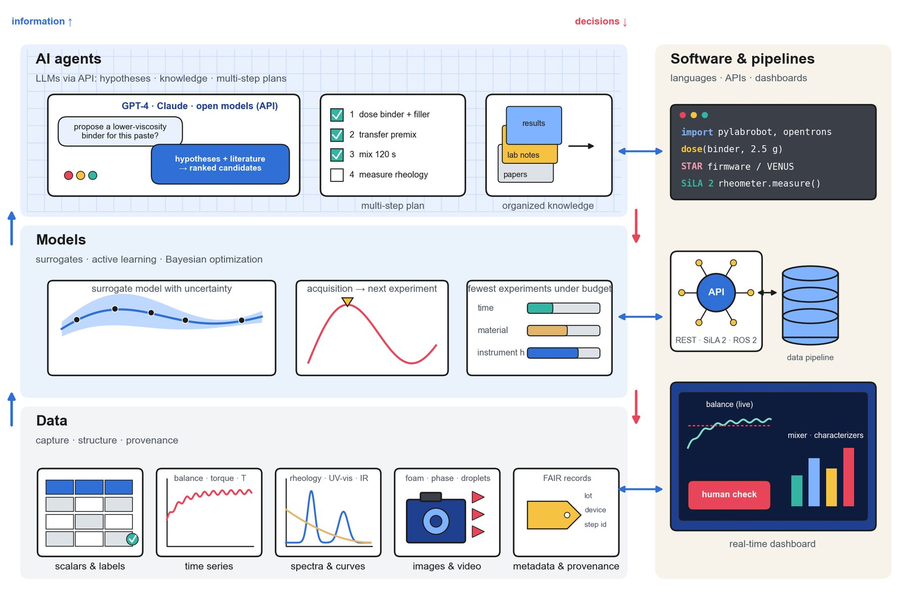

# Data & Decision Models

!!! abstract "Step 7 · Decide: What to make next?"

    This page summarizes Sections 8.1–8.2 of the review. Language models and agents are covered on [LLMs & AI Agents](agents.md). The earlier wiki page [Machine Learning](machine-learning.md) has practical model-training guidance.

A formulation SDL that can dose, move, mix, rehearse and orchestrate still needs something to decide **what to make next**. Every such decision depends on the data, models and strategies behind it.

<figure class="fig" markdown>
{ loading=lazy }
<figcaption markdown="span">**Figure 9.** The decision ladder: data (bottom), models that choose the next experiment (middle) and AI agents (top), connected to the robots by software and data pipelines (right).</figcaption>
</figure>

## What a formulation experiment records

One experiment produces several kinds of data:

| Kind | Examples |
| --- | --- |
| **Scalars and labels** | The recipe and its outcome |
| **Time series** | Balance readings, extrusion pressure, mixing torque, temperature, or the signal of a self-powered sensor [\[131\]](../references.md#ref-131) |
| **Spectra and curves** | Rheological flow curves, UV-vis or infrared spectra, the acoustic-to-electrical response of an energy-harvesting composite [\[132\]](../references.md#ref-132) |
| **Images and video** | Foam, phase separation, droplets or powder, as in the vision-guided scenarios [\[12\]](../references.md#ref-12), [\[28\]](../references.md#ref-28), [\[33\]](../references.md#ref-33) |
| **Metadata** | Ingredient lots, instrument settings, trajectories and provenance |

The data can also be split by how quickly it is used:

- **Process data** has to be acted on by the controller within seconds (see [Feedback Control](feedback-control.md)).
- **Property data** is what the planner learns from between experiments.

When experiments are stored as **FAIR** (findable, accessible, interoperable and reusable) records [\[133\]](../references.md#ref-133), every experiment can be reused, not just its headline result.

## Surrogate models and acquisition strategies

The simplest use of these data is a **surrogate model**. It maps composition and process parameters to measured properties, replacing the lookup table with a prediction.

The decisive step is choosing the next experiment. An **acquisition function** ranks candidate experiments using the surrogate's predictions and their uncertainty:

- **Active learning** samples where the model is least certain [\[134\]](../references.md#ref-134).
- **Bayesian optimization** balances that uncertainty against predicted performance to reach good formulations in few experiments [\[135\]](../references.md#ref-135). Libraries such as **BoTorch** make both routine [\[136\]](../references.md#ref-136).
- For small, low-dimensional problems, simpler sequential methods such as **simplex optimization** still work well [\[151\]](../references.md#ref-151).

These methods matter most when time, material or instrument hours are scarce, which they always are in a formulation SDL. The handling studies already use them:

- viscous pipetting [\[11\]](../references.md#ref-11);
- powdered-beverage reconstitution [\[42\]](../references.md#ref-42);
- Cao et al. combined a classifier with multi-objective Bayesian optimization on robotic platforms and found nine suitable commercial liquid formulations in 15 working days [\[137\]](../references.md#ref-137).

!!! tip "Handling data belongs in the objective"

    Engineering measurements such as a dispensing error, a torque trace or a rheology curve can go directly into the objective or the constraints. The planner then learns which recipes the hardware can make **reliably**, not only which ones perform well.

## The decision ladder

Data, models and agents form a ladder of decision making (Fig. 9):

1. structured data;
2. models that choose the next experiment;
3. agents that plan whole workflows.

Each rung needs more from the data beneath it, and that is where handling comes back in: **a planner can only learn from a dose that was actually delivered and a premix that was actually mixed.** Continue to [LLMs & AI Agents](agents.md).
