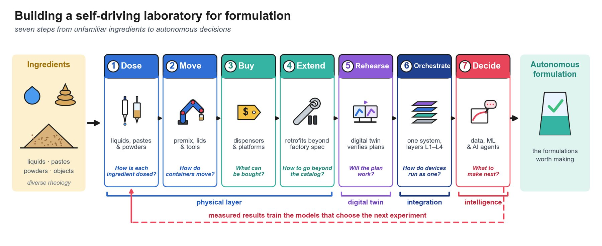
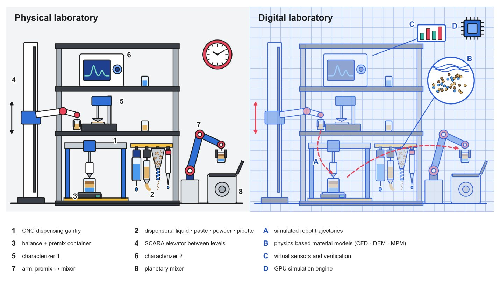
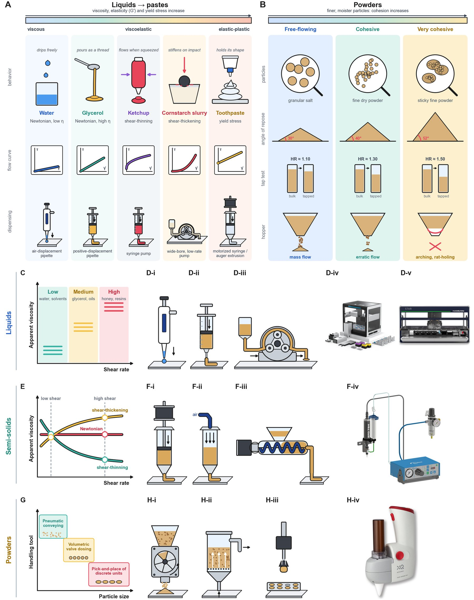
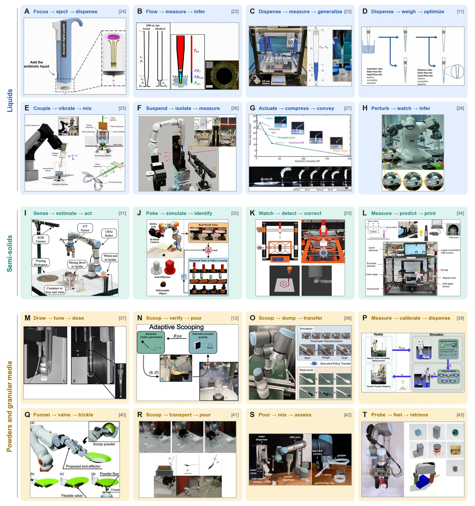
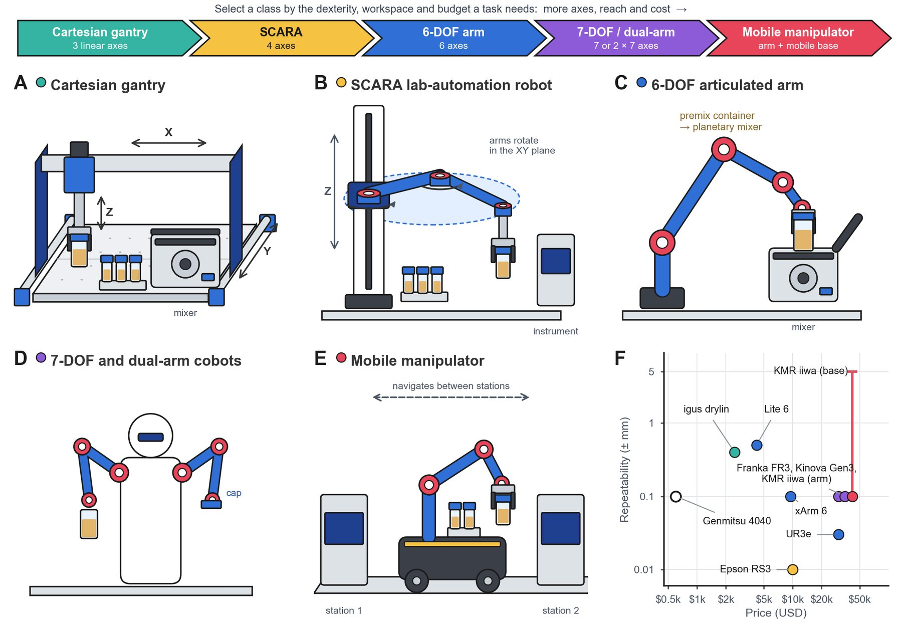
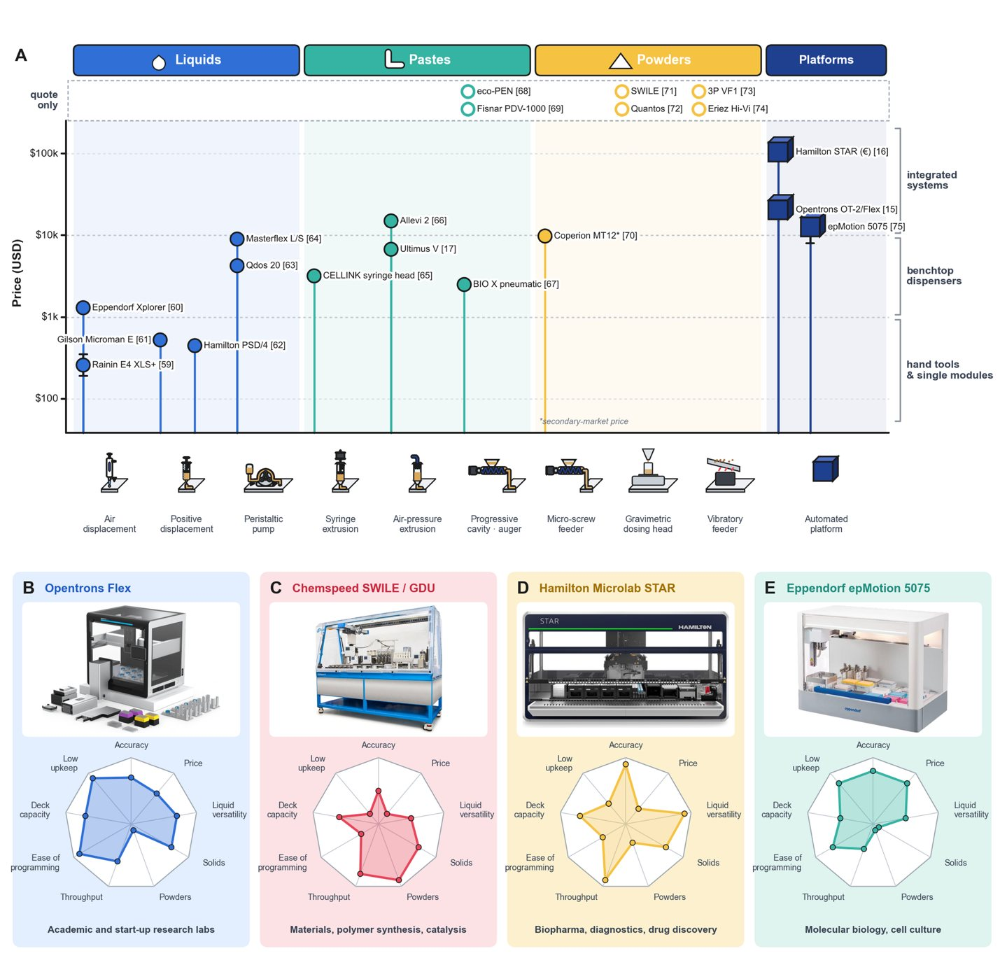
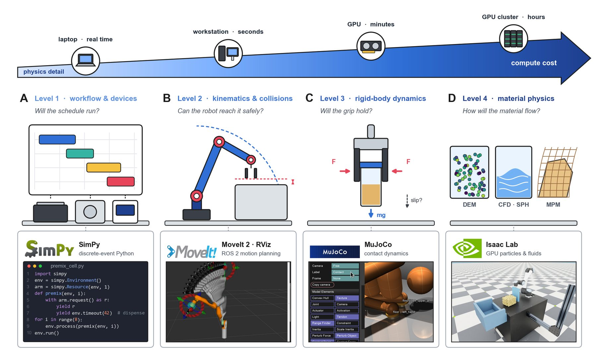
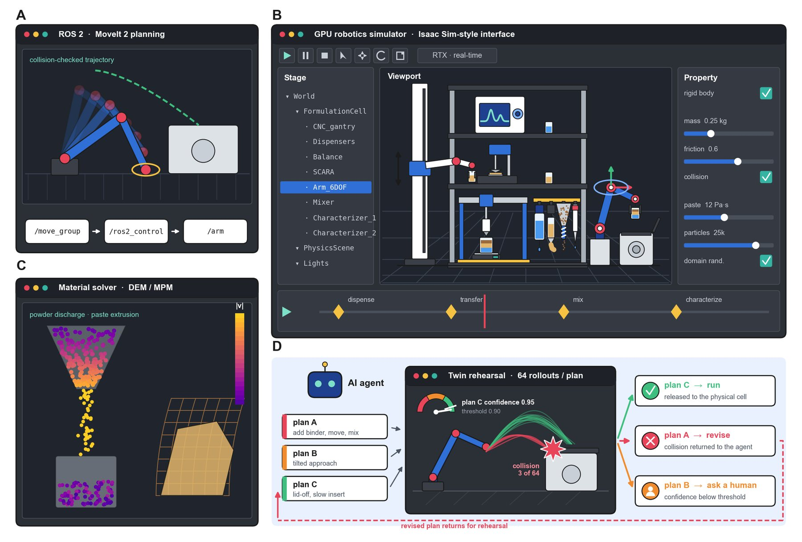
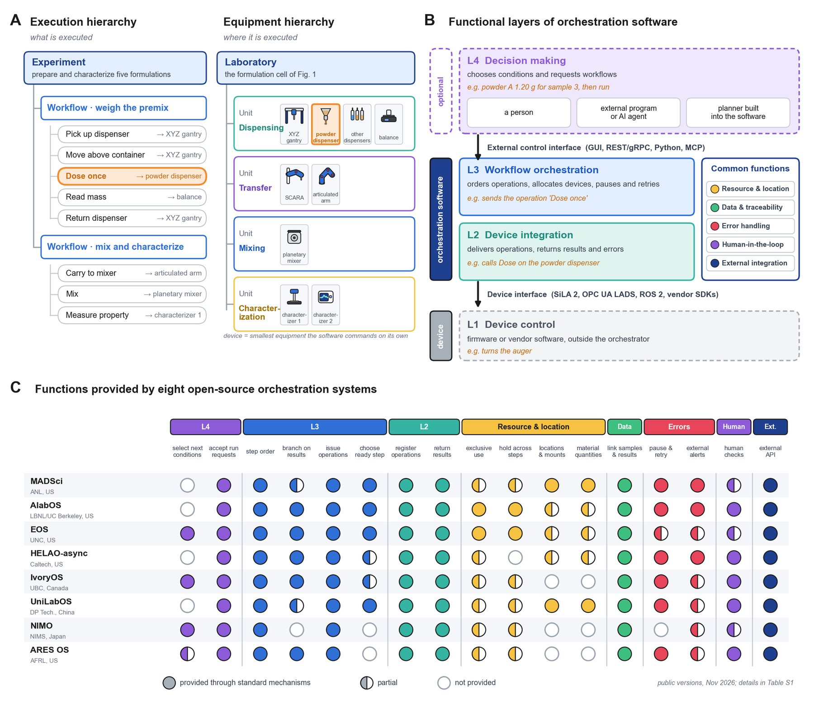
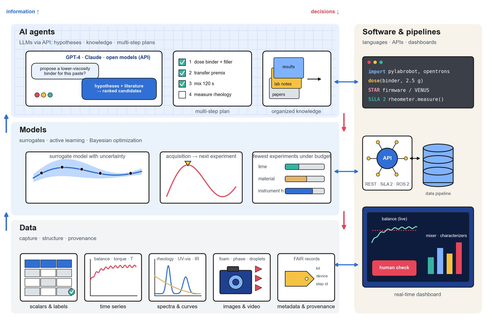

---
hide:
  - navigation
  - toc
---

# Figures

All ten figures of the review (the graphical abstract and Figures 1–9) appear here with their full captions. Click any image to enlarge it. Under each caption are links to the wiki pages that discuss that figure. Numbers in square brackets link to the [References](references.md).

{ loading=lazy }

Graphical abstract

The seven steps of a formulation SDL at a glance: dose, move, buy, extend, rehearse, orchestrate and decide.

Discussed in: [Home](index.md)

{ loading=lazy }

Figure 1

A formulation SDL and its digital twin. Physical cell (left): a CNC gantry with dispenser rack and balance (1–3), a SCARA elevator serving two characterizers (4–6) and an arm loading the mixer (7, 8). Digital twin (right): robot trajectories (A), material models (B), virtual sensors (C) and GPU simulation (D) rehearse each step before it runs.

Discussed in: [Seven-step map](steps.md)

{ loading=lazy }

Figure 2

Material properties and handling mechanisms: (A) liquids to pastes and (B) powders by cohesion; (C, E, G) selection charts and (D, F, H) mechanisms for liquids, semi-solids and powders. Product photographs adapted from Opentrons [\[15\]](references.md#ref-15), Hamilton [\[16\]](references.md#ref-16), Nordson EFD [\[17\]](references.md#ref-17) and XQ Instruments; powder dispensers are compared in [\[18\]](references.md#ref-18).

Discussed in: [Material Properties](materials/properties.md) · [Dispensing by Material Class](materials/dispensing.md)

{ loading=lazy }

Figure 3

Literature scenarios titled by their sense–act sequence and adapted from the cited studies: liquids (A–H) [\[11\]](references.md#ref-11), [\[22\]](references.md#ref-22), [\[23\]](references.md#ref-23), [\[24\]](references.md#ref-24), [\[25\]](references.md#ref-25), [\[26\]](references.md#ref-26), [\[27\]](references.md#ref-27), [\[28\]](references.md#ref-28), semi-solids (I–L) [\[31\]](references.md#ref-31), [\[32\]](references.md#ref-32), [\[33\]](references.md#ref-33), [\[34\]](references.md#ref-34) and powders and granular media (M–T) [\[12\]](references.md#ref-12), [\[37\]](references.md#ref-37), [\[38\]](references.md#ref-38), [\[39\]](references.md#ref-39), [\[40\]](references.md#ref-40), [\[41\]](references.md#ref-41), [\[42\]](references.md#ref-42), [\[43\]](references.md#ref-43).

Discussed in: [Literature Scenarios](materials/literature-scenarios.md)

{ loading=lazy }

Figure 4

Robot classes for object handling, ordered by axes, reach and cost: (A) Cartesian gantry, (B) SCARA, (C) 6-DOF arm, (D) 7-DOF or dual-arm cobot and (E) mobile manipulator; (F) repeatability versus price (Table 2).

Discussed in: [Robot Classes](object-handling/robot-classes.md)

{ loading=lazy }

Figure 5

(A) Commercial dispensers and platforms by material class, mechanism and price (hollow markers: quote only; bracketed numbers: references). (B–E) Qualitative 0–10 profiles of four platforms (‘solid handling’: labware transfer). Photographs adapted from Opentrons [\[15\]](references.md#ref-15), Chemspeed [\[71\]](references.md#ref-71), Hamilton [\[16\]](references.md#ref-16) and Eppendorf [\[75\]](references.md#ref-75).

Discussed in: [Commercial Dispensers](hardware/dispensers.md) · [Integrated Platforms](hardware/platforms.md) · [By Yield Stress & Cost](hardware/cost-accuracy.md)

{ loading=lazy }

Figure 6

Four fidelity levels of a formulation twin, (A) workflow, (B) kinematics, (C) contact dynamics and (D) material physics, at rising compute cost, with example tools (SimPy, MoveIt 2, MuJoCo, Isaac Lab; screenshots and logos from the projects’ repositories under MIT, BSD-3-Clause and Apache-2.0 licenses; logos are trademarks of their owners).

Discussed in: [Simulation & Digital Twins](simulation/index.md#the-fidelity-hierarchy)

{ loading=lazy }

Figure 7

The digital twin as a working environment: (A) motion planning in ROS 2 with MoveIt 2, (B) a GPU simulator interface, (C) a DEM/MPM material solver and (D) rehearsal of AI-proposed plans before release to the cell.

Discussed in: [Simulation & Digital Twins](simulation/index.md)

{ loading=lazy }

Figure 8

Architecture of a formulation SDL: (A) execution and equipment hierarchies, (B) functional layers of orchestration software and (C) functions provided by eight open-source systems (details in Supplementary Table S1).

Discussed in: [System Architecture & Orchestration](orchestration/index.md)

{ loading=lazy }

Figure 9

The decision ladder: data (bottom), models that choose the next experiment (middle) and AI agents (top), connected to the robots by software and data pipelines (right).

Discussed in: [Data & Decision Models](ai/data-and-decisions.md)

