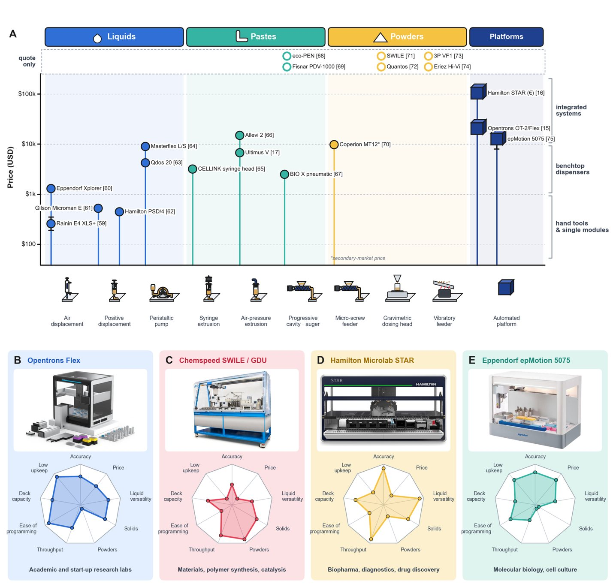

# Commercial Hardware: Cost vs. Accuracy Trade-Off

!!! warning "Illustrative estimates"

    The cost and accuracy figures on this page are **illustrative estimates from the earlier version of this wiki**, useful for reasoning about trade-offs. For sourced product accuracies and prices, use [Commercial Dispensers](dispensers.md) (Table 3), [Integrated Platforms](platforms.md) (Table 4) and [Robot Classes](../object-handling/robot-classes.md) (Table 2). Named-product figures below have been aligned with the review.

## Introduction

Automated material handling systems span a wide cost range ($1k–$500k+) with corresponding accuracy ranges (±1%–±20%). This page helps you navigate the trade-off: which system offers the best accuracy for your budget?

---

## Sourced view: price versus mechanism (Figure 5)

<figure class="fig" markdown>
{ loading=lazy }
<figcaption markdown="span">**Figure 5.** (A) Commercial dispensers and platforms by material class, mechanism and price (hollow markers: quote only; bracketed numbers: references). (B–E) Qualitative 0–10 profiles of four platforms (‘solid handling’: labware transfer). Photographs adapted from Opentrons [\[15\]](../references.md#ref-15), Chemspeed [\[71\]](../references.md#ref-71), Hamilton [\[16\]](../references.md#ref-16) and Eppendorf [\[75\]](../references.md#ref-75).</figcaption>
</figure>

---

## Cost vs. Accuracy Scatter (Typical Values)

```
Accuracy (log scale)
±0.1%  ├─ Fluidized-bed + gravimetric [High: $30–50k]
       │  Lab-grade scales + pump
       │
±1%    ├─ Gravimetric auger + feedback [Mid: $15–30k]
       │  Air-pressure syringe + real-time correction [Mid: $10–20k]
       │  Screw extrusion + iteration [Mid: $10–15k]
       │
±5%    ├─ Basic auger feeder [Low-Mid: $5–10k]
       │  Syringe pump [Low-Mid: $5–8k]
       │  Standard gripper [Low-Mid: $5–15k]
       │
±10%   ├─ Vibratory hopper [Low: $2–5k]
       │  Air-pressure syringe (no feedback) [Low: $5–8k]
       │
±20%   └─ Manual pipetting [Low: $1–2k]
         Manual powder scooping [~$0]

         |-------|-------|-------|-------|------|
         $0     $10k   $20k   $30k   $50k  $100k+ (Cost)
```

---

## Accuracy Requirements by Application

### Pharmaceutical Manufacturing

- **Tablet coating:** ±0.5% (stringent)
- **API powder dispensing:** ±1% (stringent)
- **Liquid fill:** ±2% (moderate)
- **Quality control:** ±0.1% (very stringent)

**Recommended system:** Fluidized-bed or gravimetric + feedback, cost $20–50k

---

### Chemical Synthesis (Lab Scale)

- **Liquid addition:** ±2–5% (moderate)
- **Powder reagent:** ±5% (loose)
- **Dosing multiple ingredients:** ±2% each (moderate)

**Recommended system:** Syringe pump + gravimetric scale, cost $5–15k

---

### Food/Cosmetic Ingredient Dosing

- **Texture-critical ingredients:** ±1% (stringent)
- **Volume-only ingredients:** ±5–10% (loose)
- **Batch-to-batch consistency:** ±3% (moderate)

**Recommended system:** Auger + visual verification, cost $5–10k

---

### Robotic Bin Picking

- **Position accuracy:** ±1–5 mm (moderate, depends on next step)
- **Grasp reliability:** 95%+ (behavioral; not % accuracy)
- **Cycle time:** < 10 sec (speed critical)

**Recommended system:** UR3e + parallel gripper, cost $40–50k

---

## Detailed Cost Breakdown by Component

### Liquid Handling

| Component | Low ($) | Mid ($) | High ($) | Notes |
| --- | --- | --- | --- | --- |
| Pipette/syringe | 500–2k | 5k–10k | 20k–50k | Manual, electric, automated |
| Pump | 500–2k | 3k–8k | 10k–30k | Peristaltic, gear, syringe |
| Tubing/tips | 100–500 | 1k–3k | 5k+ | Bulk for high throughput |
| Valve controller | — | 1k–3k | 5k–10k | For multi-channel |
| **Total single unit** | **~$1k** | **~$10k** | **~$50k** |  |
| **Total for 4-station setup** | **~$4k** | **~$30k** | **~$150k** |  |

---

### Powder Dispensing

| Component | Low ($) | Mid ($) | High ($) | Notes |
| --- | --- | --- | --- | --- |
| Hopper + screw | 1k–3k | 5k–10k | 15k–30k | Auger vs. vacuum vs. fluidized |
| Scale (platform) | 100–500 | 1k–3k | 5k–10k | 0.1 g to 100 kg range |
| Controller + software | — | 1k–3k | 3k–10k | Feedback logic, UI |
| Compressed air (pump) | — | 500–2k | 1k–3k | For vacuum/fluidized systems |
| **Total single unit** | **~$2k** | **~$8k** | **~$25k** |  |
| **Total for 3-station setup** | **~$6k** | **~$25k** | **~$75k** |  |

---

### Robotic Handling

| Component | Low ($) | Mid ($) | High ($) | Notes |
| --- | --- | --- | --- | --- |
| Robot arm | 10k–20k | 30k–50k | 80k–150k | Cobot vs. industrial vs. precision |
| Gripper | 1k–3k | 3k–10k | 10k–30k | Parallel, vacuum, soft, adaptive |
| F/T sensor (optional) | — | 2k–5k | 5k–10k | For force feedback |
| Vision system (optional) | — | 2k–5k | 10k–20k | Camera + lighting + software |
| Integration & software | 2k–5k | 5k–15k | 20k–50k | ROS, LabVIEW, custom |
| **Total single arm** | **~$15k** | **~$50k** | **~$150k** |  |
| **Total for 2-arm cell** | **~$30k** | **~$100k** | **~$300k** |  |

---

## Selection Matrix: Find Your Combination

### "I need ±1% accuracy, minimum cost"

**Option 1: Gravimetric feedback** (Iterative Optimization)
- Auger feeder: $5k
- Scale (0.01 g resolution): $2k
- Controller: $1k
- **Total: $8k**
- Time to achieve ±1%: 30 sec per batch (feedback cycles)

**Option 2: Manual + scale** (Characterize, Then Act)
- Manual scoop: $0
- Scale: $2k
- Model from experience: $0
- **Total: $2k**
- Time to achieve ±1%: Requires expert, 5 min per batch

**Winner:** Option 1 if repeatability required; Option 2 if one-off trials

---

### "I need 95% grasp reliability, under $50k"

**Option 1: UR3e + gripper + force feedback**
- UR3e robot: ~$30k [\[51\]](../references.md#ref-51)
- Parallel gripper: $3k
- Force/torque sensor: $2k
- ROS software: Free
- **Total: ~$35k**
- Grasp reliability: 92–95% (with real-time correction)

**Option 2: UR3e + vision system + gripper**
- UR3e robot: ~$30k [\[51\]](../references.md#ref-51)
- Camera + lighting: $3k
- Parallel gripper: $2k
- Vision-based grasping software: $3k
- **Total: ~$38k**
- Grasp reliability: 85–90% (vision occlusion limits)

**Winner:** Option 1 if occlusion is a problem; Option 2 if lighting is good

---

### "I want the fastest powder dispensing, cost no object"

**Option 1: Fluidized-bed + gravimetric + feedback**
- Fluidized-bed feeder: $25k
- Scale: $3k
- PLC controller: $1k
- Compressed air: $1k
- **Total: $30k**
- Cycle time: 15–20 sec per dose, ±0.5% accuracy

**Option 2: Vibratory hopper (open loop, no feedback)**
- Vibratory feeder: $2k
- Calibrated exit orifice: $0.5k
- **Total: $2.5k**
- Cycle time: 5 sec per dose, ±10% accuracy

**Winner:** Option 1 if accuracy matters; Option 2 if speed matters and tolerance is loose

---

## ROI Analysis: When Does Higher Cost Pay Off?

### Example: Pharmaceutical API Dispensing (1000 doses/month, API cost $500/g)

#### Scenario A: Low-Cost System ($5k)

```
Equipment cost: $5k amortized over 24 months = $208/month
Waste from ±5% errors: 50 doses × 5% × $500 = $12,500/month!
Total cost of ownership: $12,708/month
Unacceptable.
```

#### Scenario B: Mid-Cost System ($15k)

```
Equipment cost: $15k amortized = $625/month
Waste from ±1% errors: 50 doses × 1% × $500 = $2,500/month
Total cost of ownership: $3,125/month
Acceptable.
```

#### Scenario C: High-Cost System ($30k)

```
Equipment cost: $30k amortized = $1,250/month
Waste from ±0.5% errors: 50 doses × 0.5% × $500 = $1,250/month
Total cost of ownership: $2,500/month
Best option.
```

**Lesson:** For high-value materials (API, rare reagents), investing in ±0.5% accuracy system pays for itself in waste reduction.

---

## Cost-Accuracy Frontier (Pareto-Optimal Systems)

Systems where no competitor offers better accuracy for lower cost:

| System | Accuracy | Cost | Use Case | Throughput |
| --- | --- | --- | --- | --- |
| Manual + scale | ±2–5% | $1k | One-off trials | Very slow |
| Auger + manual | ±5% | $3k | Training material | Slow |
| Auger + feedback | ±1–2% | $10k | Production low-viscosity | Medium |
| Fluidized-bed | ±0.5% | $25k | Production high-value | Medium |
| UR3e + gripper | ±0.03 mm | ~$33k | Object handling | Medium–fast |
| Tecan Fluent 1080 | CV ≤3% at 10 µL, ≤0.5% at 100 µL [\[77\]](../references.md#ref-77) | $32,995–75,000 | Multi-channel liquid | Very fast |

---

## Hidden Costs (Often Forgotten)

- **Training:** $2k–$10k for operator certification
- **Validation:** $5k–$20k for GMP/FDA compliance (pharma)
- **Maintenance:** $1k–$5k/year for spare parts, calibration
- **Integration:** $5k–$50k for software, hooking up to existing systems
- **Downtime:** Lost productivity if equipment breaks (non-negotiable)
- **Calibration standards:** $1k–$5k for reference materials
- **Compressed air (if needed):** $200–$500/month supply cost

---

## Recommendation: Decision Tree

```
START
├─ Material type?
│  ├─ Liquid
│  │  ├─ Accuracy need ±5% or worse?
│  │  │  └─ → Manual pipette ($1k) or syringe pump ($5k)
│  │  └─ Accuracy need ±1–2%?
│  │     ├─ Volume < 100 mL?
│  │     │  └─ → Peristaltic or syringe pump ($5–10k)
│  │     └─ Volume > 100 mL?
│  │        └─ → Gravimetric scale + pump ($10–20k)
│  │
│  ├─ Powder
│  │  ├─ Accuracy need ±10% or worse?
│  │  │  └─ → Vibratory hopper ($2k)
│  │  ├─ Accuracy need ±2–5%?
│  │  │  └─ → Auger ± feedback ($8–15k)
│  │  └─ Accuracy need ±0.5–1%?
│  │     └─ → Fluidized-bed ($25–35k)
│  │
│  └─ Solid
│     ├─ Speed critical (< 5 sec)?
│     │  └─ → Gantry/SCARA ($50k)
│     └─ Reliability critical (>95% success)?
│        └─ → UR3e + F/T sensor + force control ($50k)
│
└─ END: Select recommended system
```

---

## Resources

- [Hardware by Material Type](by-material.md) — Detailed technology descriptions
- [Recurring Strategies](../strategies/index.md) — How to choose control strategy to pair with hardware
- [Material Properties](../materials/properties.md) — How to characterize your material before selecting equipment

---

## References

- Rastegardoost, M. M.; Bao, Z.; Sadr, S.; Abdollahi, N.; Darvish, K.; Clasky, A.; Ohsaka, H.; Le Devedec, F. *Self-Driving Laboratories for Formulation: Handling Liquids, Pastes, Powders and Objects, from Robots to Digital Twins and AI Agents.* Manuscript in preparation, 2026.
- Key references from the review: [\[15\]](../references.md#ref-15), [\[51\]](../references.md#ref-51), [\[59\]](../references.md#ref-59), [\[63\]](../references.md#ref-63), [\[70\]](../references.md#ref-70), [\[77\]](../references.md#ref-77). Full list on the [References](../references.md) page.

### Further reading (from the earlier wiki)

- Mettler-Toledo. *Dispensing & Dosing: Technology Solutions for Pharma* (White paper)
- Hamilton. *Liquid Handling Robotics: Accuracy & Throughput* (Technical guide)
- Universal Robots. *Collaborative Robot Specifications & Pricing* (Vendor data)
