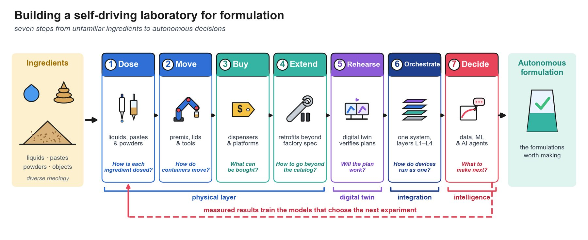

# Self-Driving Laboratories for Formulation

## A wiki for handling liquids, pastes, powders and objects

This wiki accompanies the review:

> **Self-Driving Laboratories for Formulation: Handling Liquids, Pastes, Powders and Objects, from Robots to Digital Twins and AI Agents**  
> Mohammad M. Rastegardoost<sup>a,\*</sup>, Zeqing Bao<sup>a</sup>, Sara Sadr<sup>a</sup>, Nasim Abdollahi<sup>a</sup>, Kourosh Darvish<sup>a</sup>, Aaron Clasky<sup>a</sup>, Hiroki Ohsaka<sup>b</sup>, Frantz Le Devedec<sup>a</sup>  
> <sup>a</sup> Acceleration Consortium, University of Toronto, Toronto, ON, Canada · <sup>b</sup> SEKISUI Chemical Co., Ltd., Osaka, Japan  
> <sup>\*</sup> Corresponding author: m.rastegardoost@utoronto.ca

It is a browsable, living companion to the manuscript: every page explains one part of building a formulation self-driving laboratory (SDL) in wiki form, with the review's tables, figures and 178 references linked throughout. Prefer to explore visually? The <a href="../"><strong>interactive atlas</strong></a> maps the same content onto an interactive formulation cell.

<figure markdown>

<figcaption>Graphical abstract of the review.</figcaption>
</figure>

### Core insight

Formulation (combining liquids, pastes and powders into products whose properties emerge from both composition and process) is a promising but comparatively under-automated target for SDLs. An autonomous formulation experiment is a physical choreography: ingredients of very different rheology are dosed into one premix container, which is carried to a mixer, processed and characterized, often with materials the robot has never handled. Landmark SDLs show that this physical layer, the handling of materials and the manipulation of the containers that hold them, can limit autonomy as much as the planning algorithm [\[3\]](references.md#ref-3), [\[4\]](references.md#ref-4). The guiding question at every step is the one a formulation SDL must answer for every new ingredient: **how should this material, in this container, be handled next?**

Across liquids, gels, powders and solids, a small set of [recurring strategies](strategies/index.md) emerges: characterize then act, iterative optimization, real-time correction, feedforward prediction, simulation-based generalization, physical reinvention and tactile retrieval. The review organizes the whole laboratory around seven steps.

## The seven-step map

<div class="step-grid" markdown>

<div markdown>
**1 · Dose**  
*How is each ingredient dosed?*  
[Material properties](materials/properties.md) · [Material spectrum](materials/spectrum.md) · [Dispensing by material class](materials/dispensing.md) · [Literature scenarios](materials/literature-scenarios.md) · [Recurring strategies](strategies/index.md)
</div>

<div markdown>
**2 · Move**  
*How do containers move?*  
[Robot classes for object handling](object-handling/robot-classes.md)
</div>

<div markdown>
**3 · Buy**  
*What can be bought?*  
[Commercial dispensers](hardware/dispensers.md) · [Integrated platforms](hardware/platforms.md) · [Hardware overview](hardware/index.md)
</div>

<div markdown>
**4 · Extend**  
*How to go beyond the catalog?*  
[Retrofits beyond factory spec](hardware/retrofits.md)
</div>

<div markdown>
**5 · Rehearse**  
*Will the plan work?*  
[Simulation & digital twins](simulation/index.md) · [Simulation tools](simulation/tools.md)
</div>

<div markdown>
**6 · Orchestrate**  
*How do devices run as one?*  
[Architecture & interfaces](orchestration/index.md) · [Open-source orchestration software](orchestration/open-source.md)
</div>

<div markdown>
**7 · Decide**  
*What to make next?*  
[Data & decision models](ai/data-and-decisions.md) · [LLMs & AI agents](ai/agents.md) · [AI infrastructure](ai/index.md)
</div>

</div>

See the [seven-step map](steps.md) for a short summary of each step and how it maps to the review's sections.

## Using this wiki

- **New to material handling?** Start with [Material Properties](materials/properties.md), [Material Spectrum](materials/spectrum.md) and [Dispensing by Material Class](materials/dispensing.md).
- **Choosing a technology?** Compare [Commercial Dispensers](hardware/dispensers.md), [Integrated Platforms](hardware/platforms.md) and [Robot Classes](object-handling/robot-classes.md) with sourced accuracy and price.
- **Building an autonomous lab?** Dive into [Recurring Strategies](strategies/index.md) and the [Literature Scenarios](materials/literature-scenarios.md) to see which approaches match your materials, then [Orchestration](orchestration/index.md) to run devices as one system.
- **Scaling to AI?** See [Simulation & Digital Twins](simulation/index.md), [Data & Decision Models](ai/data-and-decisions.md) and [LLMs & AI Agents](ai/agents.md).

## Quick navigation

| I want to... | Go to |
| --- | --- |
| Understand liquids, gels, powders | [Material Spectrum](materials/spectrum.md) |
| See which strategy to use for my material | [Recurring Strategies](strategies/index.md) |
| Compare commercial dispensers by accuracy and price | [Commercial Dispensers](hardware/dispensers.md) |
| Choose a robot to move premix containers | [Robot Classes](object-handling/robot-classes.md) |
| Extend a liquid handler beyond its factory spec | [Retrofits](hardware/retrofits.md) |
| Rehearse a workflow before committing material | [Simulation & Digital Twins](simulation/index.md) |
| Pick orchestration software | [Open-Source Orchestration Software](orchestration/open-source.md) |
| Learn about sensors and feedback control | [AI Infrastructure](ai/index.md) |
| Understand safety and future outlook | [Safety & Future](outlook/safety.md) |
| Contribute to this wiki | [Contributing](contributing.md) |

## Citation

If you use this resource, please cite:

> Rastegardoost, M. M.; Bao, Z.; Sadr, S.; Abdollahi, N.; Darvish, K.; Clasky, A.; Ohsaka, H.; Le Devedec, F. Self-Driving Laboratories for Formulation: Handling Liquids, Pastes, Powders and Objects, from Robots to Digital Twins and AI Agents. Manuscript in preparation, 2026.

```bibtex
@unpublished{rastegardoost2026formulation,
  title  = {Self-Driving Laboratories for Formulation: Handling Liquids, Pastes, Powders and Objects, from Robots to Digital Twins and AI Agents},
  author = {Rastegardoost, Mohammad M. and Bao, Zeqing and Sadr, Sara and Abdollahi, Nasim and Darvish, Kourosh and Clasky, Aaron and Ohsaka, Hiroki and Le Devedec, Frantz},
  note   = {Manuscript in preparation},
  year   = {2026}
}
```

---

**This is a living, open-source wiki.** See [Contributing](contributing.md) to add case studies, new strategies or commercial products, and the [Changelog](changelog.md) for what changed in the V3 rebuild.
