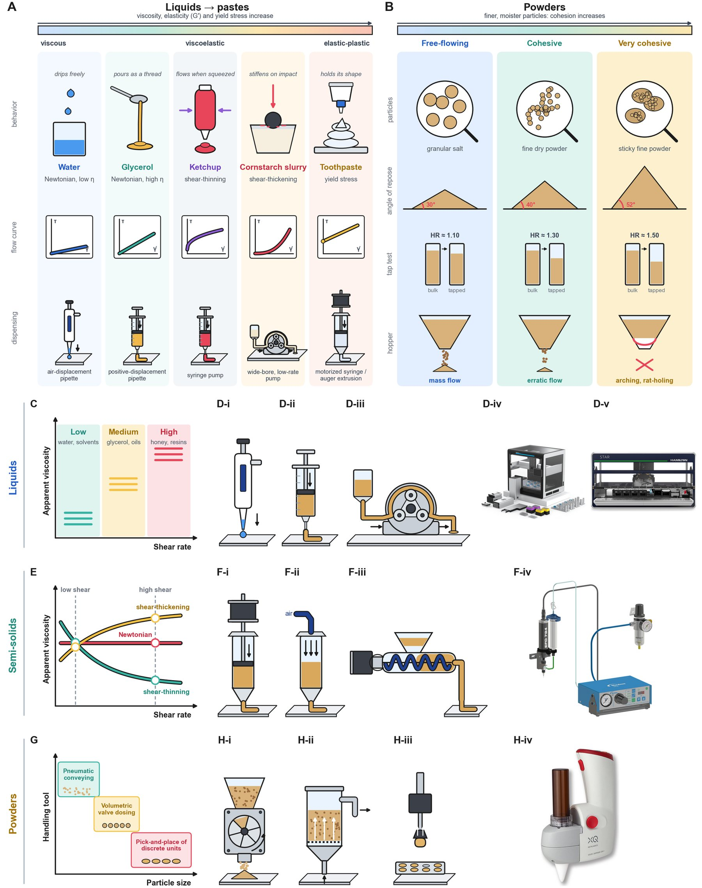

# Dispensing by Material Class

!!! abstract "Step 1 · Dose: How is each ingredient dosed?"

    This page summarizes Section 2 (*Material Handling*) of the review. The 20 studies it draws on are listed on the [Literature Scenarios](literature-scenarios.md) page, and the governing properties are covered in [Material Properties](properties.md).

How hard a material is to handle depends on how it behaves. Formulation materials run along a continuum: low-viscosity Newtonian liquids, then viscous liquids, then yield-stress gels and pastes, then powders and granular solids. Each flows and deforms differently, so each needs different handling principles [\[13\]](../references.md#ref-13), [\[14\]](../references.md#ref-14). Viscosity and rheology govern liquids and semi-solids, while flowability and cohesion govern powders.

The review groups materials by **how they are handled** rather than by strict physical state:

- **Liquids** flow freely under gravity and can be pipetted or pumped.
- **Semi-solids** have a yield stress, or a viscosity high enough that they must be extruded.
- **Powders** are particulate solids.

Newtonian and non-Newtonian behavior can occur in both fluid classes.

Each class fails in its own way:

- **Viscous liquids and gels** defeat air-displacement pipettes. The pipette has to wait for the air cushion to equilibrate, and material clings to the tip.
- **Semi-solids** that melt or set clog nozzles or need inline heating.
- **Powders** jam dosing heads and need calibration for each material.
- **Sticky or colored materials** raise cross-contamination and cleaning concerns.

## Table 1: Dispensing technologies by material class

| Material | Viscosity / Particle Size | Flow Behavior | Common Technologies | Typical Accuracy | Throughput | Key Challenges |
| --- | --- | --- | --- | --- | --- | --- |
| Low-viscosity liquids | 1–20 cP | Newtonian; shear-rate independent | Pipette, syringe, acoustic | Excellent | Very high | Splashing, evaporation |
| Medium-viscosity liquids | 20–500 cP | Newtonian to mildly shear-thinning; ~10–100 s⁻¹ working range | Syringe, gear pump | High | High | Stringing |
| High-viscosity liquids | 500–100,000 cP | Shear-thinning; characterized at low (~1–10 s⁻¹) and high (~100–1000 s⁻¹) shear | Peristaltic, piston, progressive cavity | Moderate–High | Moderate | Elasticity, pulsation |
| Gels | Yield-stress | Yield stress ~10–500 Pa; shear-thinning above yield point | Screw, pneumatic, piston | Moderate | Moderate | Yield stress, air bubbles |
| Pastes | Highly viscous | Yield stress ~100–10,000 Pa; shear-thinning, often thixotropic | Auger, extrusion | High | Moderate | Pressure lag |
| Powders | Free-flowing to cohesive | Hausner ratio ~1.00–1.11 (free-flowing) to >1.4 (very cohesive); angle of repose ~25°–>66° | Auger, vibration, gravimetric | Variable | High | Cohesion, electrostatics |
| Tablets/Pellets | Solid | NA | Pick-and-place, vacuum | Excellent | High | Grasp reliability |

<figure class="fig" markdown>
{ loading=lazy }
<figcaption markdown="span">**Figure 2.** Material properties and handling mechanisms: (A) liquids to pastes and (B) powders by cohesion; (C, E, G) selection charts and (D, F, H) mechanisms for liquids, semi-solids and powders. Product photographs adapted from Opentrons [\[15\]](../references.md#ref-15), Hamilton [\[16\]](../references.md#ref-16), Nordson EFD [\[17\]](../references.md#ref-17) and XQ Instruments; powder dispensers are compared in [\[18\]](../references.md#ref-18).</figcaption>
</figure>

## Liquids

Liquid Fig. 3A–H

Liquids are the most mature handling problem. For that reason they show most clearly where vendor defaults stop working and where sensing and feedback have to take over. Viscosity dominates automated liquid dispensing because it sets pressure losses, flow stability, droplet formation and the volumetric accuracy that can be reached [\[14\]](../references.md#ref-14), [\[19\]](../references.md#ref-19), [\[20\]](../references.md#ref-20). Most laboratory liquids are Newtonian, so a single measured viscosity is usually enough to pick a technology.

Three mechanisms cover nearly the whole range:

- **Air-displacement pipetting.** A piston moves an air cushion. This is the commercial default for low and medium viscosities [\[21\]](../references.md#ref-21).
- **Positive-displacement pipetting.** The piston touches the liquid. It is insensitive to viscosity but needs a dedicated syringe.
- **Peristaltic pumping.** Rollers squeeze a tube. It tolerates the widest range of liquids.

Volatility also matters. Volatile solvents evaporate into the air cushion of an air-displacement pipette and drip from the tip. They are usually handled by pre-wetting tips, reverse pipetting or positive displacement.

Standard air-displacement robots from Opentrons, Tecan and Hamilton handle water-like liquids with **<1% error** at high speed, and their documented range is wider than that label suggests. An Opentrons application note by Kanase and Watson [\[21\]](../references.md#ref-21) reports that unmodified GEN2 pipettes dispense up to 99% glycerol (≈900–1400 cP). Losses stay below 0.9% on the P20 and below 0.2% on the P300/P1000, provided aspiration and dispensing are slowed, settling delays are added and the tip is withdrawn more slowly. The vendor-documented ceiling therefore sits near **1,000–1,400 cP**. It exists only as a lookup table of hand-tuned settings for a few named liquids: glycerol dilutions, PEG 8000, hand sanitizer, Tween 20 and engine oil.

Eight literature scenarios go beyond this envelope (Fig. 3A–H). They differ in how they get past the lookup table:

- **Measure the viscosity directly:**
    - Mass-flow viscometry reaches 5000 cP [\[22\]](../references.md#ref-22).
    - Proxy viscometry on a standard Opentrons platform covers 20–20,000 cP [\[23\]](../references.md#ref-23).
- **Retune the pipetting:** Bayesian optimization under gravimetric feedback reaches <5% error at 1275 cP [\[11\]](../references.md#ref-11).
- **Change the hardware:**
    - A self-focusing acoustic pipet ejects picoliter droplets [\[24\]](../references.md#ref-24).
    - An acoustofluidic end-effector mixes liquids 10⁶× more viscous than water [\[25\]](../references.md#ref-25).
    - Containerless pendant-drop handling serves synchrotron X-ray measurement [\[26\]](../references.md#ref-26).
    - A soft peristaltic pump conveys liquid by compressing a soft actuator [\[27\]](../references.md#ref-27).
    - A robot infers viscosity from its own filmed flow with 88% accuracy, against 32% for human estimates [\[28\]](../references.md#ref-28).

For a formulation SDL, the lesson is that viscous ingredients do not have to be diluted or excluded. Measured viscosity, closed-loop gravimetric tuning and new dispensing hardware together extend automated liquid handling to ingredients outside the vendor's tables. Studies that modify the stock liquid handler itself are covered in [Retrofits](../hardware/retrofits.md).

## Semi-solids: pastes, gels and slurries

Semi-solid Fig. 3I–L

Semi-solids add shear-rate dependence and a yield stress to the liquid problem. The task shifts from tuning a flow rate to sensing how a material deforms. These are also the ingredients that most often define a formulated product, from creams and pastes to inks, slurries and the polymer solutions used to form porous mats [\[29\]](../references.md#ref-29).

Pastes, gels, slurries and bio-inks are typically shear-thinning, occasionally shear-thickening, and may have a yield stress below which they behave as solids. The actuator therefore has to supply enough force or shear to start the flow, and the yield stress has to be measured and compensated for consistent dispensing [\[30\]](../references.md#ref-30). Industry characterizes these materials at two representative shear rates rather than sampling the full flow curve [19]: a low rate for storage and gentle handling, and a high rate for extrusion and spraying.

Semi-solids are generally moved by extrusion:

- **Syringe-based:** precise, but needs a dedicated piston.
- **Air-pressure-driven:** gentler on shear-sensitive bio-inks, but slower to respond.
- **Screw-based:** an auger decouples flow from pressure, which suits viscous or particle-laden pastes.

The same three mechanisms scale up to industrial adhesive and sealant dispensing.

Four scenarios (Fig. 3I–L) show that a formulation SDL can infer a paste's rheology from how it responds to stirring, poking or extrusion, without a separate rheometer:

- **Stirring forces:** viscosity is estimated from stirring forces [\[31\]](../references.md#ref-31).
- **Poking with a differentiable-physics twin:** yield stress, modulus and friction are identified [\[32\]](../references.md#ref-32).
- **Vision during bioprinting:** over- and under-extrusion are corrected within about 10 s [\[33\]](../references.md#ref-33).
- **Feedforward prediction:** droplet size is predicted from bio-ink viscosity [\[34\]](../references.md#ref-34).

These studies rely more on estimation and modeling than the liquid studies do. A paste's rheology depends on its shear history, so a single viscosity reading cannot capture it. The open goal is to build in such sensing and feedback without deriving a new policy for every formulation.

## Powders and granular materials

Powder Fig. 3M–T

Powders replace continuous flow with friction and cohesion at the particle scale. As a result, **acquiring** a dose is the step most likely to fail, not delivering it. Powder flow depends on particle size, shape, density, cohesion and surface interactions, and is summarized by the angle of repose and the Hausner ratio. Cohesive powders bridge (arch) or rat-hole in hoppers, which makes dosing unpredictable. Tribocharging [\[35\]](../references.md#ref-35) and humidity cause wall adhesion and variable packing, so the same equipment rarely dispenses different powders equally well [\[12\]](../references.md#ref-12).

The right mechanism depends strongly on particle size, which ranges from cohesive sub-100 µm fines to coarse granules that flow almost like liquids:

- Fine powders can be conveyed pneumatically.
- Granules can be dosed volumetrically through rotary valves.
- Discrete units such as tablets can be picked and placed under vacuum.

At laboratory scale, three mechanisms dominate:

- **Auger or screw feeders:** continuous and volumetric.
- **Vacuum-assisted heads:** milligram doses through a narrow orifice.
- **Vibratory hoppers:** struggle with sticky or charged powders.

Commercial systems such as the Chemspeed Gravimetric Dispensing Unit (GDU) and the Mettler-Toledo Quantos perform very differently depending on powder properties, and often jam or need per-material calibration [\[18\]](../references.md#ref-18). The stakes are high. Autonomous solid-state synthesis [\[4\]](../references.md#ref-4) and a self-driving pharmaceutical tableting line [\[36\]](../references.md#ref-36) both start every experiment with automated powder dosing, so the choice and calibration of the dosing mechanism directly limit what these platforms can make.

Eight scenarios go beyond fixed dispensers (Fig. 3M–T):

- **Tuned vacuum transfer:** ≤0.1% RSD milligram transfers [\[37\]](../references.md#ref-37).
- **Vision-guided deep-RL scooping:** ~1.93 mg error across seven powders [\[12\]](../references.md#ref-12).
- **Simulation-trained scooping:** transfers to unseen powders [\[38\]](../references.md#ref-38).
- **Simulators calibrated from flowability:** extend to cohesive, unseen powders [\[39\]](../references.md#ref-39).
- **Soft funnel-shaped hand:** doses to ±2 mg [\[40\]](../references.md#ref-40).
- **Chainable RL policies from a differentiable granular simulator** [\[41\]](../references.md#ref-41).
- **Bayesian optimization with computer-vision foam assessment** [\[42\]](../references.md#ref-42).
- **Tactile retrieval of buried objects** [\[43\]](../references.md#ref-43).

Related work coordinates excavation and deposition of cohesive granular media [\[44\]](../references.md#ref-44), and Lo et al.'s low-cost Frugal Twin fills and melts wax powder into candles [\[45\]](../references.md#ref-45).

For a formulation SDL, the powder step is where generalization is hardest, because every new powder changes flowability. The methods that transfer best are those that **sense or simulate** the powder rather than assume its behavior. Once the ingredients are dosed, the premix itself becomes an object that has to be moved: see [Object Handling](../object-handling/robot-classes.md).

