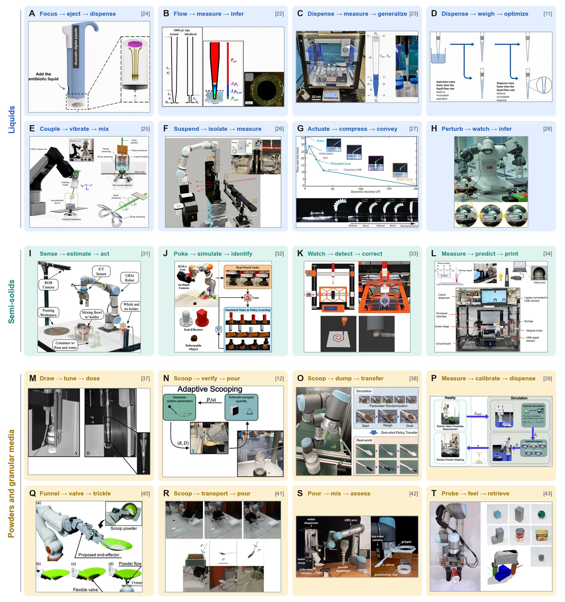

# Literature Scenarios (Figure 3)

!!! abstract "Step 1 · Dose"

    The review condenses recent work on adaptive material handling into **20 literature scenarios**, each named after its sense–act sequence: liquids (A–H), semi-solids (I–L), and powders and granular media (M–T). The scenarios cover different scales and were validated on different materials. They illustrate complementary strategies (measure, retune or redesign) and are not directly comparable benchmarks.

<figure class="fig" markdown>
{ loading=lazy }
<figcaption markdown="span">**Figure 3.** Literature scenarios titled by their sense–act sequence and adapted from the cited studies: liquids (A–H) [\[11\]](../references.md#ref-11), [\[22\]](../references.md#ref-22), [\[23\]](../references.md#ref-23), [\[24\]](../references.md#ref-24), [\[25\]](../references.md#ref-25), [\[26\]](../references.md#ref-26), [\[27\]](../references.md#ref-27), [\[28\]](../references.md#ref-28), semi-solids (I–L) [\[31\]](../references.md#ref-31), [\[32\]](../references.md#ref-32), [\[33\]](../references.md#ref-33), [\[34\]](../references.md#ref-34) and powders and granular media (M–T) [\[12\]](../references.md#ref-12), [\[37\]](../references.md#ref-37), [\[38\]](../references.md#ref-38), [\[39\]](../references.md#ref-39), [\[40\]](../references.md#ref-40), [\[41\]](../references.md#ref-41), [\[42\]](../references.md#ref-42), [\[43\]](../references.md#ref-43).</figcaption>
</figure>

## All 20 scenarios

| Panel | Material class | Sense–act sequence | Study | Ref |
|---|---|---|---|---|
| 3A | liquid | focus → eject → dispense | Zhang et al. | [\[24\]](../references.md#ref-24) |
| 3B | liquid | flow → measure → infer | Deshmukh et al. | [\[22\]](../references.md#ref-22) |
| 3C | liquid | dispense → measure → generalize | Soh et al. | [\[23\]](../references.md#ref-23) |
| 3D | liquid | dispense → weigh → optimize | Velasco et al. | [\[11\]](../references.md#ref-11) |
| 3E | liquid | couple → vibrate → mix | Durrer et al. | [\[25\]](../references.md#ref-25) |
| 3F | liquid | suspend → isolate → measure | Ozgulbas | [\[26\]](../references.md#ref-26) |
| 3G | liquid | actuate → compress → convey | Xu et al. | [\[27\]](../references.md#ref-27) |
| 3H | liquid | perturb → watch → infer | Walker et al. | [\[28\]](../references.md#ref-28) |
| 3I | semi-solid | sense → estimate → act | Luo et al. | [\[31\]](../references.md#ref-31) |
| 3J | semi-solid | poke → simulate → identify | Yang et al. | [\[32\]](../references.md#ref-32) |
| 3K | semi-solid | watch → detect → correct | Kelly et al. | [\[33\]](../references.md#ref-33) |
| 3L | semi-solid | measure → predict → print | Shin et al. | [\[34\]](../references.md#ref-34) |
| 3M | powder | draw → tune → dose | Fermier et al. | [\[37\]](../references.md#ref-37) |
| 3N | powder | scoop → verify → pour | Radulov et al. | [\[12\]](../references.md#ref-12) |
| 3O | powder | scoop → dump → transfer | Kadokawa et al. | [\[38\]](../references.md#ref-38) |
| 3P | powder | measure → calibrate → dispense | Radulov et al. | [\[39\]](../references.md#ref-39) |
| 3Q | powder | funnel → valve → trickle | Takahashi et al. | [\[40\]](../references.md#ref-40) |
| 3R | powder | scoop → transport → pour | Wei et al. | [\[41\]](../references.md#ref-41) |
| 3S | powder | pour → mix → assess | Szymańska et al. | [\[42\]](../references.md#ref-42) |
| 3T | powder | probe → feel → retrieve | Xu et al. | [\[43\]](../references.md#ref-43) |

## Liquids (A–H)

Liquid

All eight liquid scenarios run into the same limit: there is no measurement of how an unfamiliar liquid will behave. They cover picoliter to milliliter volumes.

- **A · focus → eject → dispense.** Zhang et al.'s self-focusing acoustic pipet ejects picoliter droplets without contact [\[24\]](../references.md#ref-24).
- **B · flow → measure → infer.** Deshmukh et al.'s mass-flow viscometry measures viscosity directly, up to 5000 cP [\[22\]](../references.md#ref-22).
- **C · dispense → measure → generalize.** Proxy viscometry on a standard Opentrons platform covers 20–20,000 cP [\[23\]](../references.md#ref-23).
- **D · dispense → weigh → optimize.** Bayesian-optimized pipetting under gravimetric feedback replaces the vendor's per-liquid table and reaches <5% error at 1275 cP [\[11\]](../references.md#ref-11).
- **E · couple → vibrate → mix.** Durrer et al.'s acoustofluidic end-effector mixes liquids 10⁶× more viscous than water [\[25\]](../references.md#ref-25).
- **F · suspend → isolate → measure.** Ozgulbas et al.'s containerless pendant-drop handling supports synchrotron X-ray measurement [\[26\]](../references.md#ref-26).
- **G · actuate → compress → convey.** Xu et al.'s soft peristaltic pump [\[27\]](../references.md#ref-27).
- **H · perturb → watch → infer.** Walker et al.'s robot infers viscosity from video of the flow it induces, using a convolutional neural network. It is right 88% of the time, against 32% for human estimates [\[28\]](../references.md#ref-28). The scenario asks whether viscosity needs to be known at all.

## Semi-solids (I–L)

Semi-solid

- **I · sense → estimate → act.** Luo et al.'s pancake-batter robot estimates viscosity from stirring forces, using a force/torque sensor and a camera, and plans a pouring trajectory with a small neural network. It remains calibrated to one material [\[31\]](../references.md#ref-31).
- **J · poke → simulate → identify.** Yang et al. poke an unknown paste with an end-effector that has a camera in hand. A differentiable-physics twin recovers the paste's yield stress, modulus and friction coefficient, and the method generalizes across materials [\[32\]](../references.md#ref-32).
- **K · watch → detect → correct.** Kelly et al. close the loop on extrusion bioprinting, correcting over- and under-extrusion from computer vision within about 10 s [\[33\]](../references.md#ref-33).
- **L · measure → predict → print.** Shin et al. predict droplet size and volume from bio-ink viscosity and print parameters before printing, the feedforward counterpart of K [\[34\]](../references.md#ref-34).

## Powders and granular media (M–T)

Powder / granular

- **M · draw → tune → dose.** Fermier et al. tuned vacuum flow and orifice size to reach ≤0.1% RSD on milligram transfers, for one powder and offline [\[37\]](../references.md#ref-37).
- **N · scoop → verify → pour.** Radulov et al. use vision-guided deep reinforcement learning (DRL) to scoop, correct the volume in real time and reach ~1.93 mg error across seven powders [\[12\]](../references.md#ref-12).
- **O · scoop → dump → transfer.** Kadokawa et al. train a policy entirely in simulation that transfers to unseen powders without retuning [\[38\]](../references.md#ref-38).
- **P · measure → calibrate → dispense.** A simulator is calibrated from measured flowability and generalizes to cohesive, unseen powders [\[39\]](../references.md#ref-39).
- **Q · funnel → valve → trickle.** Takahashi et al.'s soft funnel-shaped hand trickles milligram doses through a valve to ±2 mg [\[40\]](../references.md#ref-40).
- **R · scoop → transport → pour.** Three chainable RL policies are bootstrapped from Wei et al.'s differentiable granular simulator [\[41\]](../references.md#ref-41).
- **S · pour → mix → assess.** Bayesian optimization combined with computer-vision foam assessment reconstitutes a powdered beverage [\[42\]](../references.md#ref-42). This is a complete formulate-and-evaluate loop in miniature.
- **T · probe → feel → retrieve.** Xu et al. retrieve an object of unknown shape buried in granular media using tactile feedback alone [\[43\]](../references.md#ref-43).

## Mapping scenarios to the recurring strategies

The [seven recurring strategies](../strategies/index.md) of this wiki group the same studies by control philosophy. Some scenarios fit more than one strategy.

| Strategy | Scenarios |
| --- | --- |
| [Characterize, then act](../strategies/characterize-act.md) | B [\[22\]](../references.md#ref-22), C [\[23\]](../references.md#ref-23), I [\[31\]](../references.md#ref-31), P [\[39\]](../references.md#ref-39) |
| [Iterative optimization](../strategies/iterative-optimization.md) | D [\[11\]](../references.md#ref-11), M [\[37\]](../references.md#ref-37), S [\[42\]](../references.md#ref-42) |
| [Real-time correction](../strategies/real-time-correction.md) | K [\[33\]](../references.md#ref-33), N [\[12\]](../references.md#ref-12) |
| [Feedforward prediction](../strategies/feedforward-prediction.md) | H [\[28\]](../references.md#ref-28), L [\[34\]](../references.md#ref-34) |
| [Simulation-based generalization](../strategies/simulation-generalization.md) | J [\[32\]](../references.md#ref-32), O [\[38\]](../references.md#ref-38), P [\[39\]](../references.md#ref-39), R [\[41\]](../references.md#ref-41) |
| [Physical reinvention](../strategies/physical-reinvention.md) | A [\[24\]](../references.md#ref-24), E [\[25\]](../references.md#ref-25), F [\[26\]](../references.md#ref-26), G [\[27\]](../references.md#ref-27), Q [\[40\]](../references.md#ref-40) |
| [Tactile retrieval](../strategies/tactile-retrieval.md) | T [\[43\]](../references.md#ref-43) |
