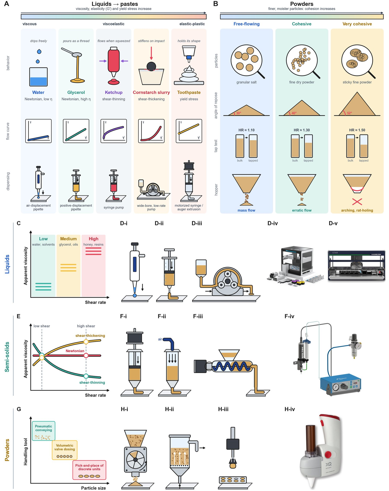

# Material Properties Governing Handling Strategies

!!! info "Updated to manuscript V3"

    The review groups formulation materials by **how they are handled**: liquids (pipetted or pumped), semi-solids (yield stress or viscosity high enough to require extrusion) and powders (particulate solids) [\[13\]](../references.md#ref-13), [\[14\]](../references.md#ref-14). Its Table 1, reproduced on [Dispensing by Material Class](dispensing.md), gives the working ranges used throughout this wiki: low-viscosity liquids 1–20 cP, medium 20–500 cP, high 500–100,000 cP; gels with yield stress ~10–500 Pa; pastes ~100–10,000 Pa, often thixotropic; powders from free-flowing (Hausner ratio ~1.00–1.11) to very cohesive (>1.4), with angles of repose from ~25° to >66°. Industry characterizes semi-solids at two representative shear rates (low, ~1–10 s⁻¹, and high, ~100–1000 s⁻¹) rather than the full flow curve [\[19\]](../references.md#ref-19); tribocharging [\[35\]](../references.md#ref-35) and humidity drive wall adhesion in powders.

<figure class="fig" markdown>
{ loading=lazy }
<figcaption markdown="span">**Figure 2.** Material properties and handling mechanisms: (A) liquids to pastes and (B) powders by cohesion; (C, E, G) selection charts and (D, F, H) mechanisms for liquids, semi-solids and powders. Product photographs adapted from Opentrons [\[15\]](../references.md#ref-15), Hamilton [\[16\]](../references.md#ref-16), Nordson EFD [\[17\]](../references.md#ref-17) and XQ Instruments; powder dispensers are compared in [\[18\]](../references.md#ref-18).</figcaption>
</figure>

## Overview

The key physical properties of liquids, semi-solids, and powders determine which automated handling strategy is most appropriate. Materials span a continuum from low-viscosity Newtonian liquids to highly viscous pastes, yield-stress fluids, powders, and solid dosage forms.

## Rheological Properties

### Viscosity and Flow Behavior

**Viscosity** is the dominant parameter governing automated liquid dispensing because it directly influences:
- Pressure losses
- Flow stability  
- Droplet formation
- Achievable volumetric accuracy

**Newtonian fluids** (constant viscosity) are easier to pump and dispense. Examples: water (~1 cP), glycerol (~1500 cP).

**Non-Newtonian fluids** exhibit viscosity that changes with shear rate:
- **Shear-thinning** materials become less viscous at high shear (e.g., polymer solutions, food sauces)
- **Shear-thickening** materials harden under stress (rare in labs)
- **Yield-stress** (Bingham) fluids behave like solids until applied stress exceeds their yield point (e.g., certain gels, pastes)

### Yield Stress

Materials with yield stress require sufficient force or shear to initiate flow. Handling these requires:
- Pumps or robotic actuators that provide enough force
- Feedback loops to detect when flow starts
- Special dispensing strategies (sense→estimate→act; watch→detect→correct)

Standard air-displacement pipettes typically fail above ~100 cP viscosity.

## Semi-Solids and Gels

Semi-solid materials (pastes, adhesives, bio-inks) often combine:
- **Viscous behavior** at rest (storage)
- **Elastic behavior** under stress (recovers shape)
- **Yield stress** below which they behave like a solid

Industry characterizes them at two representative shear rates:
- **Low shear** (storage, gentle handling)
- **High shear** (extrusion, spraying)

Rather than sampling the full flow curve.

## Powder Properties

Powder handling depends on multiple interrelated properties:

### Flowability Metrics

- **Angle of repose** — the angle at which a powder forms a stable pile
- **Hausner ratio** — ratio of tapped to poured bulk density
- These reflect interparticle friction and cohesion

### Particle Size Distribution

- **Very fine powders** (dust-like, < 100 µm) may require fluidized or vacuum-assisted feeding
- **Coarse granules** may not compact well and flow more readily
- **Cohesive fines** can agglomerate or bridge, making dosing unpredictable

### Surface Interactions

- **Electrostatic charge** (tribocharging) causes powders to cling to surfaces
- **Moisture sensitivity** — hygroscopic powders absorb water, changing flowability
- **Surface area** affects interparticle forces

### Common Failure Modes

- **Bridging** (arch formation) — powder gets stuck in the hopper
- **Rat-holing** (funnel flow) — flow channels through the powder, leaving unmixed material
- **Caking** — compaction due to moisture or pressure

## Table: Material Properties and Handling Implications

| Property | Low-Viscosity Liquid | High-Viscosity Liquid | Gel/Paste | Free-Flowing Powder | Cohesive Powder | Solid |
| --- | --- | --- | --- | --- | --- | --- |
| Viscosity (cP) | 1–20 | 100–100,000 | Yield-stress | N/A | N/A | N/A |
| Yield Stress | None | None | 10–10,000 Pa | None | Variable | High |
| Handling Challenge | Splashing | Stringing, air bubbles | Pressure lag, yield stress | Cohesion, electrostatics | Bridging, rat-holing | Grasp reliability |
| Typical Strategy | Characterize (viscosity) | Iterative optimization | Real-time correction | Simulation generalization | Real-time correction | Tactile retrieval |
| Sensing Need | Low | Medium (temperature, flow) | Medium (pressure) | High (vision, weight) | High (weight, fill height) | High (touch, force) |

## References

- Rastegardoost, M. M.; Bao, Z.; Sadr, S.; Abdollahi, N.; Darvish, K.; Clasky, A.; Ohsaka, H.; Le Devedec, F. *Self-Driving Laboratories for Formulation: Handling Liquids, Pastes, Powders and Objects, from Robots to Digital Twins and AI Agents.* Manuscript in preparation, 2026.
- Key references from the review: [\[13\]](../references.md#ref-13), [\[14\]](../references.md#ref-14), [\[19\]](../references.md#ref-19), [\[20\]](../references.md#ref-20), [\[30\]](../references.md#ref-30), [\[35\]](../references.md#ref-35). Full list on the [References](../references.md) page.

### Further reading (from the earlier wiki)

- Tadros, T. F. (2010). *Rheology of Dispersions: Principles and Applications*. Wiley-VCH.
- Mezger, T. G. (2020). *The Rheology Handbook* (5th ed.). Vincentz Network.
- Barnes, H. A. (2000). *A Handbook of Elementary Rheology*. University of Wales Institute.
- Malkin, A. Y., Derkach, S. R., & Kulichikhin, V. G. (2023). Rheology of gels and yielding liquids. *Gels*, 9(9), 715.
