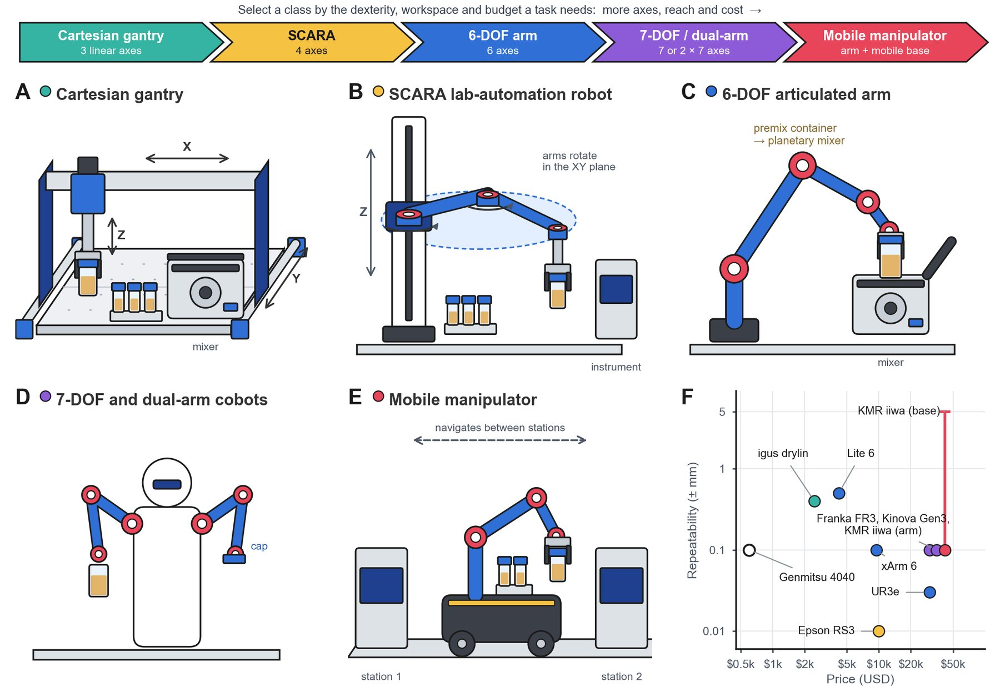

# Robot Classes for Object Handling

!!! abstract "Step 2 · Move: How do containers move?"

    Summarizes Section 3 (*Object Handling in Formulation SDLs*) and Table 2 of the review.

Material handling moves matter. **Object handling** moves the vessels and tools that hold or dispense it. In a formulation SDL, a robot has to:

- carry the premix container from the dispensing station to a planetary or overhead mixer;
- open and close instrument lids;
- bring a dispensing tool to a container, or a container to a fixed dispenser;
- cap and uncap vials;
- load samples into characterization instruments.

These are rigid objects of known geometry, so the problem is one of reach, repeatability, payload and integration, not rheology. Even so, object handling gates every step of the formulation. A dose can only go into a container that is in the right place, and a premix can only be mixed once it reaches the mixer.

<figure class="fig" markdown>
{ loading=lazy }
<figcaption markdown="span">**Figure 4.** Robot classes for object handling, ordered by axes, reach and cost: (A) Cartesian gantry, (B) SCARA, (C) 6-DOF arm, (D) 7-DOF or dual-arm cobot and (E) mobile manipulator; (F) repeatability versus price (Table 2).</figcaption>
</figure>

## The five robot classes

Object handling Containers, lids, tools and vials

### Cartesian gantries

A Cartesian gantry moves a tool along orthogonal linear axes over a fixed deck. Gantries are the cheapest and simplest robots to program. Examples:

- A desktop Genmitsu 4040-PRO CNC frame costs **$599** and accepts a gripper or dispensing tool. The vendor quotes ±0.1 mm running accuracy for the series [\[46\]](../references.md#ref-46).
- The igus drylin XYZ gantry reaches 0.3–0.5 mm repeatability for under $2,500 [\[47\]](../references.md#ref-47).
- The open-source Jubilee platform costs about **$1,400** in parts and can swap between a gripper and a pipette [\[48\]](../references.md#ref-48).

All of them are confined to their frame and can only move objects in-plane and vertically.

### SCARA lab-automation robots

A SCARA robot rides a vertical elevator axis while two revolute links rotate in the horizontal plane. This gives fast, stiff transfers between stations at different heights. The Precise Automation PF400 [\[49\]](../references.md#ref-49) is common in laboratory automation for tube and plate handling and repeats to ±0.09 mm. The Epson RS3 [\[50\]](../references.md#ref-50) repeats to ±0.010 mm. Neither can tilt a container or reach into an instrument from the side.

### 6-DOF articulated arms

Six-degree-of-freedom arms can orient the gripper freely. They can open a hinged mixer lid, insert a premix container or tilt a vessel to pour. Prices vary almost tenfold, from the Universal Robots UR3e (±0.03 mm, about $30,000) [\[51\]](../references.md#ref-51) to the UFACTORY xArm 6 (±0.1 mm, $9,500) [\[52\]](../references.md#ref-52) and Lite 6 (±0.5 mm, about $4,200) [\[53\]](../references.md#ref-53). Arms can also operate equipment designed for people, such as pressing buttons, turning knobs and opening doors, so an SDL can use unmodified benchtop instruments.

### 7-DOF and dual-arm collaborative robots

Seven-degree-of-freedom and dual-arm cobots add redundancy for working around clutter, and a second hand for tasks such as uncapping. Examples are the Franka Research 3 [\[54\]](../references.md#ref-54), the Kinova Gen3 [\[55\]](../references.md#ref-55) and the dual-arm robot in Lunt et al.'s solid-state workflow [\[56\]](../references.md#ref-56).

### Mobile manipulators

A mobile manipulator mounts an arm on an autonomous base, so it can carry samples between stations spread across a laboratory. Examples are the mobile robotic chemist [\[3\]](../references.md#ref-3), built on a KUKA KMR iiwa, and the synthesis workflow of Dai et al. [\[57\]](../references.md#ref-57). The arm repeats to about ±0.1 mm, but the base only relocates to within a few millimeters: about ±5 mm for the KMR iiwa, which sells for about $42,000 on the reseller market [\[58\]](../references.md#ref-58). Each docking is therefore usually followed by local re-referencing, such as touching or imaging a fiducial, before the arm grasps [\[3\]](../references.md#ref-3).

### End-effectors

In every class, the end-effector matters as much as the arm:

- Parallel-jaw grippers with container-specific fingers suit vials and premix containers.
- Vacuum cups suit plates and lids.
- Tool changers let one arm switch between grippers, pipettes and dispensers.
- Compliant fingers designed from a container-shape taxonomy let one gripper handle many vessel shapes [\[85\]](../references.md#ref-85).

## Table 2: Repeatability and price

| Robot class | Brand | Model | Repeatability | Price | Ref |
| --- | --- | --- | --- | --- | --- |
| Cartesian gantry pick-and-place | SainSmart | Genmitsu 4040-PRO CNC | ±0.1 mm running accuracy* | $599 | [\[46\]](../references.md#ref-46) |
|  | igus | drylin XYZ Gantry | 0.3–0.5 mm | $2,461 | [\[47\]](../references.md#ref-47) |
|  | Machine Agency | Jubilee (tool-changing) + CNC (gantry) | – | ~$1,400 | [\[48\]](../references.md#ref-48) |
| SCARA lab-automation robot | Precise Automation | PreciseFlex PF400 | ±0.09 mm | Quote | [\[49\]](../references.md#ref-49) |
|  | Epson | RS3 SCARA | ±0.010 mm | ~$10,000 | [\[50\]](../references.md#ref-50) |
| 6-DOF articulated arm | Universal Robots | UR3e | ±0.03 mm | ~$30,000 | [\[51\]](../references.md#ref-51) |
|  | UFACTORY | xArm 6 | ±0.1 mm | $9,500 | [\[52\]](../references.md#ref-52) |
|  | UFACTORY | Lite 6 | ±0.5 mm | ~$4,200 | [\[53\]](../references.md#ref-53) |
| 7-DOF collaborative arm | Franka Robotics | Franka Research 3 | <±0.1 mm | ~$30,000 | [\[54\]](../references.md#ref-54) |
|  | Kinova | Gen3 | ~±0.1 mm | ~$35,000 | [\[55\]](../references.md#ref-55) |
| Mobile manipulator | KUKA | KMR iiwa | ±0.1 mm arm; ~±5 mm base positioning | ~$42,000 (reseller) | [\[3\]](../references.md#ref-3), [\[58\]](../references.md#ref-58) |

\*Vendor running accuracy of the Genmitsu 4040 series; no repeatability is published.

## Choosing a class

The choice depends on the task, not the material:

| If... | Choose |
| --- | --- |
| All stations share one deck | Cartesian gantry |
| Throughput and repeatability dominate | SCARA |
| Containers must be tilted, inserted or manipulated around instrument geometry (e.g. loading a premix into a mixer) | 6-DOF articulated arm |
| Work is cluttered or needs a second hand (e.g. uncapping) | 7-DOF or dual-arm cobot |
| Stations cannot be co-located | Mobile manipulator |

Repeatability and price are only loosely linked (Fig. 4F). Price follows mechanism class, payload and build effort, and the cheapest credible option, an open-source gantry, is not a commercial product at all. The grippers and tool changers on these robots also carry dispensing tools to containers. Object handling is therefore the layer through which every dispensing method on the [Dispensing by Material Class](../materials/dispensing.md) page is deployed.

**Next:** what a formulation SDL can simply buy, in [Commercial Dispensers](../hardware/dispensers.md) and [Integrated Platforms](../hardware/platforms.md).
