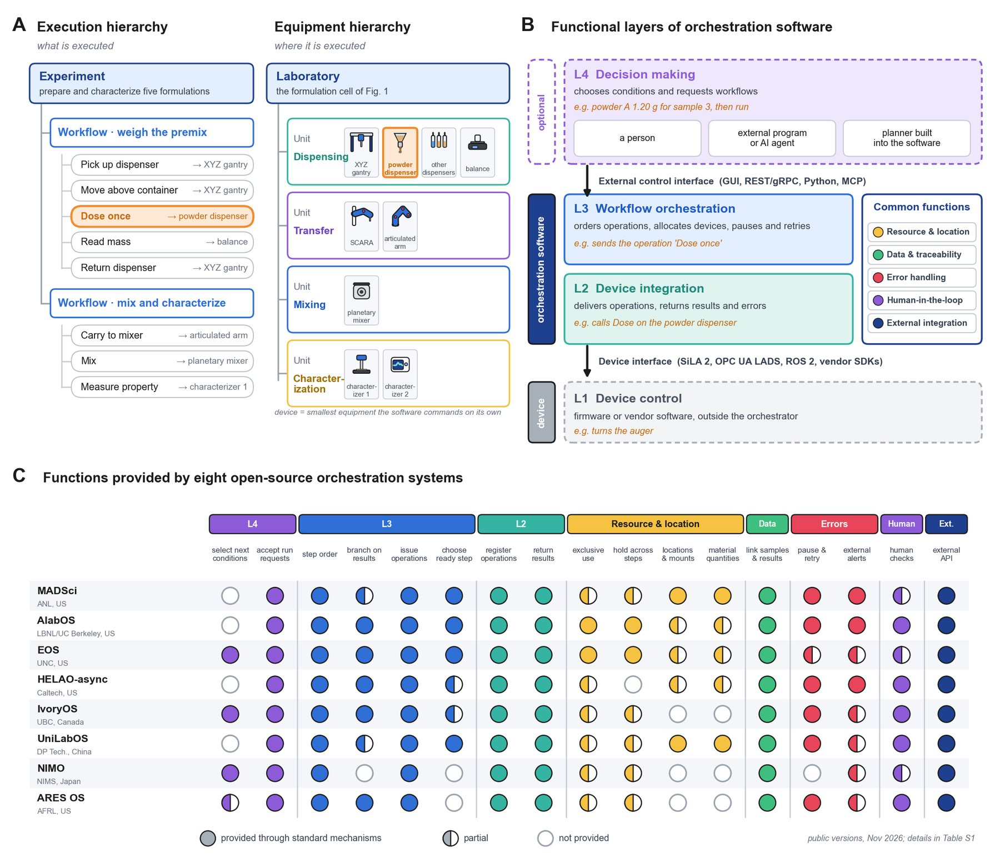

# System Architecture & Orchestration

!!! abstract "Step 6 · Orchestrate: How do devices run as one?"

    This page summarizes Sections 7.1 and 7.3 of the review. The comparison of eight open-source systems (Section 7.2 and Supplementary Table S1) is on [Open-Source Orchestration Software](open-source.md).

Dispensers, robots, retrofits and a digital twin only become a self-driving laboratory when software runs them as one system. In a formulation SDL, that software has to run dispensing, transfer, mixing and characterization devices in sequence as a single experiment. Tools are swapped, containers move and ingredients are used up, so the software also has to track:

- what is mounted where;
- which container holds which premix;
- how much material remains.

The review calls this layer **orchestration software**.

<figure class="fig" markdown>
{ loading=lazy }
<figcaption markdown="span">**Figure 8.** Architecture of a formulation SDL: (A) execution and equipment hierarchies, (B) functional layers of orchestration software and (C) functions provided by eight open-source systems (details in Supplementary Table S1).</figcaption>
</figure>

## Terms: two hierarchies

Two hierarchies describe where an SDL executes and what it executes (Fig. 8A).

**Equipment hierarchy (where):**

- **Laboratory:** the complete cell.
- **Unit:** a group of devices that together perform one process step.
- **Device:** the smallest piece of equipment the software can command on its own.

The cell in [Figure 1](../steps.md) has four units:

- a dispensing unit (gantry, dispensers and balance);
- a transfer unit (SCARA and articulated arm);
- a mixing unit;
- a characterization unit.

**Execution hierarchy (what):**

- **Experiment:** preparing and characterizing a set of formulations.
- **Workflow:** device operations ordered by their dependencies, possibly spanning several units.
- **Device operation:** a single command to one device, such as dosing powder once.

Orchestration systems use their own names for groupings between these levels (task, protocol, sequence, campaign). The review uses the neutral terms above so the systems can be compared.

## Four functional layers

The functions of orchestration software fall into four layers (Fig. 8B):

| Layer | Role |
| --- | --- |
| **L4 · Decision making** | Chooses experimental conditions and requests workflows. It may be a person, an external program or AI agent, or a planner built into the software. |
| **L3 · Workflow orchestration** | Orders device operations, allocates devices, and pauses or retries execution. |
| **L2 · Device integration** | Delivers operations to devices and returns their results and errors. |
| **L1 · Device control** | Drives motors and reads sensors in firmware or vendor software. This layer sits outside the orchestrator. |

Five common functions cut across the layers:

- resource and location management;
- data and traceability;
- error handling;
- human-in-the-loop support;
- external integration.

**Resource and location management matters most for formulation**, because tool changes, container transfers and material consumption change the state of the cell at every step.

## Interfaces to devices and decision makers

Orchestration software meets the laboratory through two interfaces.

### Device interface (L2 ↔ L1)

Laboratory standards describe device capabilities in a common format across manufacturers:

- **SiLA 2** defines typed device features with discovery, progress notifications and status subscriptions [\[167\]](../references.md#ref-167).
- **OPC UA LADS** builds information models for laboratory and analytical devices on industrial OPC UA [\[168\]](../references.md#ref-168).
- **ROS 2** plays the same role for robots [\[96\]](../references.md#ref-96).

Devices without such support are driven through vendor SDKs, APIs, or serial and TCP commands wrapped in device adapters. Examples:

- the Opentrons Python Protocol API drives Opentrons liquid handlers [\[15\]](../references.md#ref-15);
- PyLabRobot exposes Hamilton, Tecan and Opentrons platforms through one interface [\[88\]](../references.md#ref-88);
- Hamilton STAR systems are programmed through the vendor's VENUS environment.

Among the eight open-source systems:

- EOS and ARES OS call SiLA 2 devices directly.
- MADSci mainly uses REST nodes.
- UniLabOS offers ROS 2 as an option.
- NIMO registers devices as MCP servers.

Data standards such as **AnIML** and **Allotrope** define how results are stored, not how devices are controlled [\[169\]](../references.md#ref-169), [\[170\]](../references.md#ref-170).

### External control interface (L4 ↔ L3)

This interface connects decision makers to the orchestrator. It can take the form of graphical interfaces, REST or gRPC APIs, Python clients and, increasingly, the **Model Context Protocol (MCP)** for AI agents [\[171\]](../references.md#ref-171). All eight systems expose HTTP or gRPC APIs, and EOS, UniLabOS and NIMO also support MCP. An agent connected through MCP may itself act as L4, or it may call a planner inside the software. MCP support alone therefore does not determine where decisions are made.

Data flows both ways through these interfaces. Validated measurements stream to models, and decisions come back as executable workflows. Real-time dashboards let researchers watch balances, mixers and characterizers, see what the planner proposed and step in when a value drifts.

The [digital twin](../simulation/index.md#a-layered-architecture-and-the-verification-gate) sits behind the same interface and rehearses each requested workflow before L3 releases it to the devices. What remains is deciding which workflows to request: see [Data & Decision Models](../ai/data-and-decisions.md) and [LLMs & AI Agents](../ai/agents.md).
