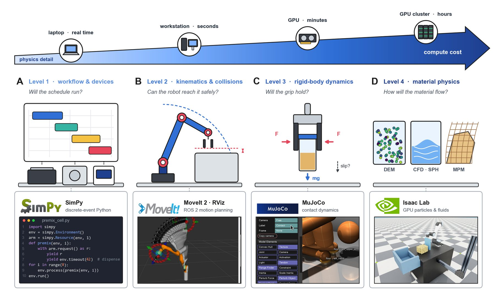
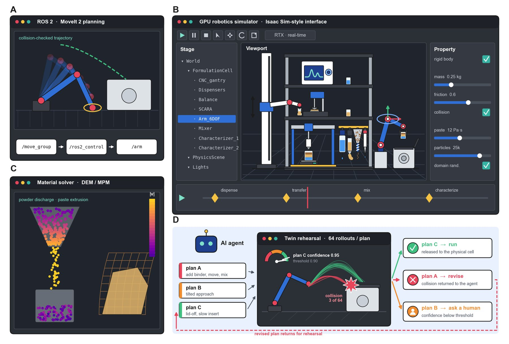

# Simulation & Digital Twins

!!! abstract "Step 5 · Rehearse: Will the plan work?"

    Summarizes Section 6 (*Simulation and Digital Twins in SDLs*) of the review. The tool comparison (Table 6) is on [Simulation Tools](tools.md). The earlier wiki page [Digital Twins & LLMs](../ai/digital-twins.md) adds worked examples.

Hardware selection and customization decide what a platform can physically do. Simulation can predict whether a planned handling step will work before anyone tries it. In a formulation SDL, one experiment chains dispensing, transfer, mixing and characterization, so a single failed step can waste the whole premix. The most valuable simulations are therefore the ones that **rehearse handling**. The mobile robotic chemist [\[3\]](../references.md#ref-3) and the mobile-robot synthesis workflow of Dai et al. [\[57\]](../references.md#ref-57) both invested heavily in grasping, transfer and docking, and commissioning those steps on hardware is slow and risks collisions.

A **digital twin** extends a simulation into a persistent virtual counterpart of one specific system. It shares that system's geometry, kinematics and device logic and is kept consistent with its measured state [\[89\]](../references.md#ref-89), [\[90\]](../references.md#ref-90). Twins are established in the chemical process industry and are being extended to whole research laboratories through knowledge graphs and connected data infrastructure [\[91\]](../references.md#ref-91), [\[92\]](../references.md#ref-92), [\[93\]](../references.md#ref-93). Unlike a one-off simulation, a twin is part of the laboratory's operating loop, where it can plan, check and explain each handling action in a formulation.

This page covers simulation of the hardware workflow: the robots, devices and materials. Predicting experimental outcomes and making decisions are the job of the [surrogate models and planners](../ai/data-and-decisions.md).

## The fidelity hierarchy

Simulations for SDLs differ mainly in how much physics they resolve. Each of the four levels adds physical detail and computational cost.

| Level | Resolves | Answers | Example tools |
| --- | --- | --- | --- |
| **1 · Workflow** | Workflows and devices, no geometry | Throughput, scheduling conflicts, orchestration testing | SimPy [\[94\]](../references.md#ref-94); device emulators under SiLA / SiLA 2 [\[95\]](../references.md#ref-95) |
| **2 · Kinematics** | Geometry and joint kinematics | Reachability, collision-free paths, clearances, cycle time | MoveIt 2 [\[97\]](../references.md#ref-97), kinematic twins |
| **3 · Contact dynamics** | Masses, friction, contact | Grasp stability, controller response | MuJoCo, PhysX, Bullet, ODE |
| **4 · Material physics** | The material itself | Dispensed mass, powder flow | CFD/SPH (liquids), DEM (powders), MPM (pastes) |

- **Level 1** emulates workflows and devices without geometry. Discrete-event simulation, for example with SimPy [\[94\]](../references.md#ref-94), estimates throughput and scheduling conflicts. Device emulators can be swapped in for real instruments under standards such as SiLA [\[95\]](../references.md#ref-95) and its successor SiLA 2, so orchestration software can be tested before the hardware arrives.
- **Level 2** adds geometry and joint kinematics. It answers most layout questions: reachability, collision-free paths, clearances and cycle time.
- **Level 3** adds masses, friction and contact, which are needed for grasp stability and controller response.
- **Level 4** resolves the material itself: liquids by computational fluid dynamics (CFD) or smoothed-particle hydrodynamics (SPH), powders by the discrete element method (DEM) and pastes by the material point method (MPM). It is the only level that can predict a dispensed mass or a powder flow.

<figure class="fig" markdown>
{ loading=lazy }
<figcaption markdown="span">**Figure 6.** Four fidelity levels of a formulation twin, (A) workflow, (B) kinematics, (C) contact dynamics and (D) material physics, at rising compute cost, with example tools (SimPy, MoveIt 2, MuJoCo, Isaac Lab; screenshots and logos from the projects’ repositories under MIT, BSD-3-Clause and Apache-2.0 licenses; logos are trademarks of their owners).</figcaption>
</figure>

## Simulators and material models

The **Robot Operating System 2 (ROS 2)** is the middleware through which most research robots, simulators and planners exchange data [\[96\]](../references.md#ref-96). Robots are described in the Unified Robot Description Format (URDF). The ros2_control abstraction lets the same code drive a simulated robot or a physical one, so a routine validated in simulation can be deployed unchanged. MoveIt 2 [\[97\]](../references.md#ref-97) adds motion planning with TRAC-IK [\[98\]](../references.md#ref-98), OMPL [\[99\]](../references.md#ref-99) and FCL [\[100\]](../references.md#ref-100), and visualization in RViz. ROS also underpins chemistry systems such as ARChemist [\[101\]](../references.md#ref-101) and the multi-robot solid-state workflow of Lunt et al. [\[56\]](../references.md#ref-56).

Several engines provide rigid-body physics, with varying ROS integration: **Gazebo** [\[102\]](../references.md#ref-102), **MuJoCo** [\[103\]](../references.md#ref-103), **PyBullet** [\[104\]](../references.md#ref-104), **CoppeliaSim** [\[105\]](../references.md#ref-105) and **Webots** [\[106\]](../references.md#ref-106). **NVIDIA Isaac Sim** adds:

- GPU-simulated deformables and particle fluids;
- photorealistic synthetic data of glassware and liquids;
- massively parallel learning through Isaac Gym [\[107\]](../references.md#ref-107), Orbit [\[108\]](../references.md#ref-108) and Isaac Lab [\[109\]](../references.md#ref-109).

The cost is an RTX-class GPU. Its interface combines a scene hierarchy, a physically rendered viewport and per-object physics properties, so a whole formulation cell can be assembled and stepped through its workflow.

Chemistry-specific twins are starting to appear. **Chemistry3D** simulates robotic chemistry tasks with liquids and visualizes temperature, color and pH changes [\[110\]](../references.md#ref-110). **MATTERIX** couples manipulation with powder and liquid dynamics, device functions and simple kinetics, and reports sim-to-real transfer [\[111\]](../references.md#ref-111). Vendor tools such as URSim and RoboDK are the easiest to adopt but rarely model instruments or materials.

<figure class="fig" markdown>
{ loading=lazy }
<figcaption markdown="span">**Figure 7.** The digital twin as a working environment: (A) motion planning in ROS 2 with MoveIt 2, (B) a GPU simulator interface, (C) a DEM/MPM material solver and (D) rehearsal of AI-proposed plans before release to the cell.</figcaption>
</figure>

### Material models by class

The tools differ most in how they handle the material, because the fidelity needed rises with rheological complexity.

| Material | Resolved models | What robotics simulators do |
| --- | --- | --- |
| **Liquids** | Volume-of-fluid CFD [\[112\]](../references.md#ref-112), SPH [\[113\]](../references.md#ref-113) | Real-time position-based particle fluids [\[114\]](../references.md#ref-114). They capture where liquid goes when a container tilts, which is enough for learned pouring [\[115\]](../references.md#ref-115) but not for sub-microliter errors. |
| **Gels and pastes** | Bingham, Herschel-Bulkley or elasto-viscoplastic models, handled naturally by MPM [\[116\]](../references.md#ref-116), [\[117\]](../references.md#ref-117) | MPM underpins deformable-manipulation benchmarks such as PlasticineLab [\[118\]](../references.md#ref-118). Differentiable versions (DiffTaichi [\[119\]](../references.md#ref-119), FluidLab [\[120\]](../references.md#ref-120)) let handling trajectories be optimized through the physics. |
| **Powders** | DEM [\[121\]](../references.md#ref-121), with contact parameters calibrated from bulk tests [\[122\]](../references.md#ref-122); continuum μ(I) rheology [\[123\]](../references.md#ref-123) | GPU engines approximate powders only qualitatively. |
| **Rigid vials and lids** | Rigid-body dynamics with domain randomization [\[124\]](../references.md#ref-124) | Well supported. |

No single simulator covers this range quantitatively. Robotics simulators integrate robots but treat materials qualitatively, and specialized solvers do the opposite. Co-simulation and differentiable multi-material engines are the routes to closing the gap [\[111\]](../references.md#ref-111), [\[120\]](../references.md#ref-120).

## Benefits

Simulation offers SDLs four benefits:

1. **Layout and program verification.** Kinematic twins check layout and verify programs before installation.
2. **Gating autonomous actions.** A twin can release each command proposed by a planner or LLM agent [\[125\]](../references.md#ref-125), [\[126\]](../references.md#ref-126), [\[127\]](../references.md#ref-127) only if it is free of collisions and forbidden states. This extends the verification already applied to LLM-generated chemistry plans [\[126\]](../references.md#ref-126) from syntax to geometry.
3. **Synthetic data and skill training.** Rendering with domain randomization [\[124\]](../references.md#ref-124) produces labeled images of glassware and liquids, which chemistry simulators such as Chemistry3D are starting to provide [\[110\]](../references.md#ref-110). Parallel and differentiable simulators train handling skills [\[107\]](../references.md#ref-107), [\[108\]](../references.md#ref-108), [\[109\]](../references.md#ref-109), [\[119\]](../references.md#ref-119), [\[120\]](../references.md#ref-120).
4. **Failure detection.** A twin kept in sync with sensor data flags handling failures as mismatches between prediction and measurement.

## Limitations

Four limitations bound these benefits:

1. **The sim-to-real gap.** It is well documented for robot learning [\[128\]](../references.md#ref-128) and grows with rheological complexity, because for liquids, gels and powders it is set by the material model.
2. **Unknown parameters.** The parameters DEM and MPM need are rarely known for new materials.
3. **Compute cost.** Resolved Level 4 simulations take minutes to hours per event.
4. **Scarce shared assets.** Instrument models, shared description formats (URDF, SDF, MJCF, USD, SiLA 2) and validation against the physical cell are all scarce.

## A layered architecture and the verification gate

Simulation is converging on a layered architecture with three parts:

- a **kinematic, device-level twin** that checks every action cheaply;
- a **GPU physics platform** for contact dynamics and learned skills;
- **material-resolved solvers**, called only where material flow decides the outcome.

A twin calibrated from a few observations of an unfamiliar ingredient could even suggest how to dispense it, and how the premix will behave in the mixer, before the first gram is committed.

Placed between the planner and the hardware, the same twin becomes a **verification gate** (Fig. 7D). Each proposed action is rehearsed first, then:

- released if it passes;
- returned for revision if it fails;
- referred to a human if confidence is low.

This is the deliberate safeguarding that increasingly autonomous science requires [\[129\]](../references.md#ref-129), [\[130\]](../references.md#ref-130). A laboratory that can rehearse a formulation still needs software to run its dispensers, robots, instruments and twin as one system. That is covered in [Orchestration](../orchestration/index.md).
