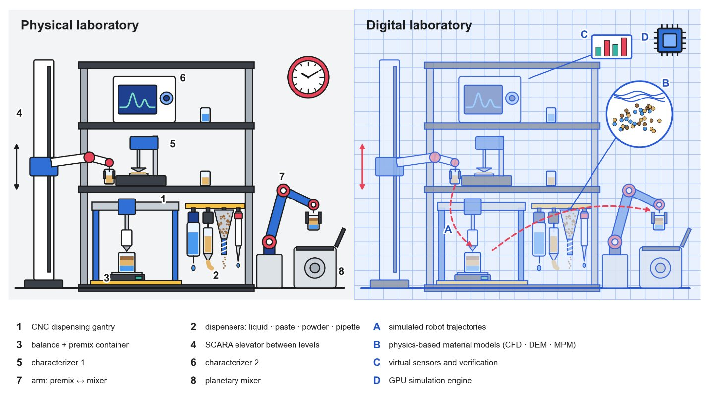

# The Seven Steps of a Formulation SDL

The review looks at formulation from the point of view of a self-driving laboratory and treats building one as a sequence of steps. Each step answers one question that a team building or extending such a laboratory has to settle. The focus throughout is on physical execution and how it couples to sensing, feedback control and experimental planning. By separating fixed automation from systems that adapt their actions to measured material behavior, the review identifies the solutions available today, the capabilities still missing and the trends likely to shape the next generation of formulation SDLs.

<figure markdown>

<figcaption><strong>Figure 1.</strong> A formulation SDL and its digital twin. Physical cell (left): a CNC gantry with dispenser rack and balance (1–3), a SCARA elevator serving two characterizers (4–6) and an arm loading the mixer (7, 8). Digital twin (right): robot trajectories (A), material models (B), virtual sensors (C) and GPU simulation (D) rehearse each step before it runs.</figcaption>
</figure>

## Why the physical layer matters

SDLs close the loop between experiment design, robotic execution and data analysis [\[1\]](references.md#ref-1). Flagship platforms have started to deliver on formulation-like problems. A mobile robotic chemist optimized photocatalyst formulations on its own across a human-scale laboratory, running 688 experiments over eight days [\[3\]](references.md#ref-3). The A-Lab targets solid-state synthesis rather than formulation, but it showed that robotic powder dosing and mixing can run unattended at scale [\[4\]](references.md#ref-4). The idea is older than the name: the robot scientist Adam [\[5\]](references.md#ref-5), the Chemputer [\[6\]](references.md#ref-6) and closed-loop thin-film discovery [\[7\]](references.md#ref-7) each joined planning, execution and characterization in their own way.

These successes also show how much execution costs. Burger et al.'s robotic chemist [\[3\]](references.md#ref-3) took substantial engineering so that one robot could navigate the laboratory and dispense, degas and sample ten reagents across several workstations. The A-Lab [\[4\]](references.md#ref-4) synthesized 41 of 58 targeted compounds. None of its 17 failures was attributed to handling, yet every result depended on powder dosing, mixing and transfer routines engineered in advance for a fixed set of materials and containers. Groups that operate SDLs keep naming hardware integration and adaptive material handling as persistent barriers to autonomy [\[1\]](references.md#ref-1), [\[8\]](references.md#ref-8).

Decision making has advanced in parallel. Bayesian optimization selects formulations on tight budgets [\[137\]](references.md#ref-137), and agents built on large language models have planned and run chemistry on robots [\[125\]](references.md#ref-125), [\[127\]](references.md#ref-127). These methods can only act through hardware that doses, moves and measures materials reliably.

## The steps

| Step | Question | Review section | Wiki pages |
| --- | --- | --- | --- |
| **1 · Dose** | How is each ingredient dosed? | 2. Material Handling | [Properties](materials/properties.md), [Spectrum](materials/spectrum.md), [Dispensing by class](materials/dispensing.md), [Literature scenarios](materials/literature-scenarios.md), [Strategies](strategies/index.md) |
| **2 · Move** | How do containers move? | 3. Object Handling in Formulation SDLs | [Robot classes](object-handling/robot-classes.md) |
| **3 · Buy** | What can be bought? | 4. Commercial Handling Solutions and Integrated Platforms | [Dispensers](hardware/dispensers.md), [Integrated platforms](hardware/platforms.md) |
| **4 · Extend** | How to go beyond the catalog? | 5. Customizing Platforms Beyond Their Factory Specification | [Retrofits](hardware/retrofits.md) |
| **5 · Rehearse** | Will the plan work? | 6. Simulation and Digital Twins in SDLs | [Simulation & digital twins](simulation/index.md), [Tools](simulation/tools.md) |
| **6 · Orchestrate** | How do devices run as one? | 7. System Architecture and Orchestration | [Architecture](orchestration/index.md), [Open-source systems](orchestration/open-source.md) |
| **7 · Decide** | What to make next? | 8. Data, Machine Learning, and AI Agents in Formulation SDLs | [Data & models](ai/data-and-decisions.md), [AI agents](ai/agents.md) |

### 1 · Dose

This step links the properties that govern liquids, semi-solids and powders (viscosity, yield stress, flowability) to the mechanisms used to handle them. It also reviews how recent studies sense, model and correct the dispensing of unfamiliar ingredients. Twenty literature scenarios, each named after its sense–act sequence, show how far past vendor defaults each material class can be pushed.

### 2 · Move

After dosing, the premix becomes an object that has to be moved. Five robot classes carry containers, open lids and load instruments: Cartesian gantries, SCARA robots, 6-DOF arms, 7-DOF or dual-arm cobots and mobile manipulators. The choice depends on the task, not the material.

### 3 · Buy

This step compares commercial dispensers and integrated platforms on accuracy and cost. Price follows mechanism and ecosystem rather than accuracy, and outside liquid handling it is rarely public.

### 4 · Extend

Low-cost retrofits push purchased platforms past their factory specifications. Examples include new end-effectors, sensors mounted through the tool changer and hardware-agnostic control software.

### 5 · Rehearse

Simulation and digital twins let a laboratory rehearse and check a workflow before any material is committed. The review organizes them in a four-level fidelity hierarchy, and a twin can also act as a gate on autonomous actions.

### 6 · Orchestrate

Orchestration software runs the dispensers, robots, instruments and twin as one system. It tracks what is mounted where, which container holds which premix and how much material is left.

### 7 · Decide

Data, surrogate models, acquisition strategies and AI agents choose the next experiment and assist the people who run the laboratory. They connect to the hardware through APIs and data pipelines.

## Outlook

The review ends with four directions:

- **Shared benchmarks:** reference liquids, pastes and powders, plus reference premix-transfer tasks.
- **Open interfaces** between planners, software and hardware.
- **Calibrated twins** validated against the physical cell.
- **Safeguards that scale with autonomy** [\[129\]](references.md#ref-129), [\[130\]](references.md#ref-130).

See [Future Directions](outlook/future-directions.md).
